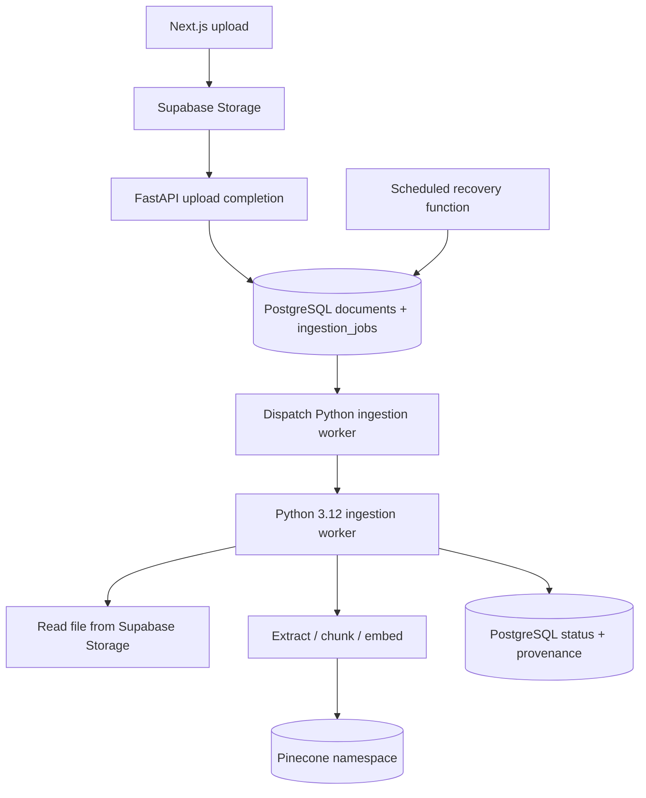
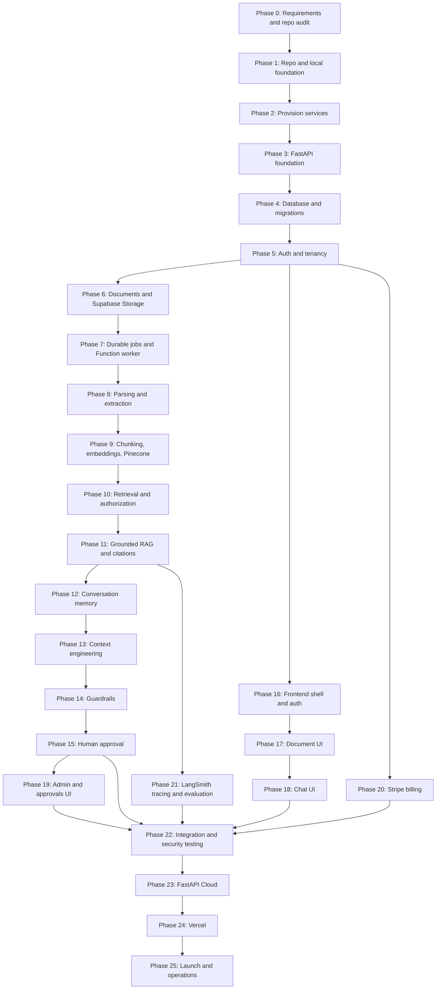

# ATLAS Enterprise AI

> **TECHNOLOGY AMENDMENT (2026-11-07):** Former Appwrite Auth/Database/Storage/Functions requirements are **replaced by Supabase Auth + Supabase PostgreSQL + Supabase Storage**, plus a **Python ingestion worker**. See `docs/supabase-migration.md`. Prefer that document, `requirements.md`, `architecture.md`, and `environments.md` for current stack truth.

# Detailed Phase-by-Phase Implementation Plan

**Document version:** 1.0  
**Created:** November 7, 2026  
**Status:** Proposed implementation roadmap  
**Project:** Atlas Enterprise AI — multi-tenant enterprise knowledge copilot  
**Primary source plan:** [`3. Atlas_Implementation_Steps.md`](https://github.com/entbappy/ATLAS-Enterprise-AI/blob/main/docs/3.%20Atlas_Implementation_Steps.md)  
**Related project documents:**
- `Atlas_Enterprise_AI_Project_Documentation.md` — project overview, technology responsibilities, system architecture, functionality, data model, and security requirements.
- `ATLAS_Complete_Setup_and_Testing_Guide.md` — local setup, provider configuration, testing, and deployment instructions.

---

## 1. Purpose of This Implementation Plan

This document converts the original Atlas implementation sequence into a complete engineering roadmap for building the updated Atlas Enterprise AI system.

The original plan is retained as the foundation:

1. Setup and infrastructure.
2. Document ingestion and RAG.
3. Observability.
4. FastAPI and user interface.
5. Integration and validation.

The implementation is expanded into independently testable phases covering application foundations, identity, multi-tenancy, document lifecycle, durable ingestion, retrieval, grounded generation, memory, context engineering, guardrails, human approval, subscriptions, observability, production deployment, and operations.

The objective is not to build a simple chatbot. The objective is to build a secure, maintainable, multi-tenant enterprise knowledge platform whose answers are grounded in permitted documents and whose sensitive operations are controlled, auditable, and observable.

### 1.1 How to use this plan

Implement the phases in order unless a documented dependency permits otherwise. Each phase must have:

- A clear implementation scope.
- A defined set of modules, APIs, or UI components.
- Tests proving the phase works.
- Acceptance criteria that can be reviewed before moving forward.
- Updated documentation and environment examples where necessary.

Do not implement all phases in one large coding task. Complete a phase, review its output, run its tests, and then move to the next phase.

### 1.2 Required coding-agent workflow

A coding agent working in the Atlas repository must follow this approval-gated process:

1. Read this implementation plan and the related project overview and setup guide before changing code.
2. Inspect the existing repository, folder structure, dependency files, migrations, tests, and completed implementation. Never assume a module is missing without checking.
3. When asked to work on a phase, first prepare a detailed, repository-aware implementation plan for that phase. Include files to create/update, dependencies, data-flow changes, risks, and tests.
4. Stop and wait for explicit approval before writing or modifying implementation code.
5. After approval, implement only the approved phase. Do not silently start later phases or replace the selected technology stack.
6. Run the relevant automated tests, formatting, linting, and type checks. Report exact commands and results. Do not claim a test passed unless it was actually run.
7. Update this plan's completion status only when the implementation and acceptance criteria have been verified.

If a requirement conflicts with the existing repository or another project document, report the conflict and propose a decision. Do not silently rewrite this plan or change the architecture.

---

## 2. Product Scope and Target Capabilities

Atlas is a multi-tenant enterprise knowledge copilot. Organizations create workspaces, upload approved internal documents, and ask questions through a conversational interface. The assistant retrieves relevant evidence, generates grounded responses, cites sources, and supports follow-up questions.

### 2.1 Core capabilities

| Capability | Required behavior |
|---|---|
| Authentication | Supabase Auth supports registration, sign-in, sign-out, password recovery, sessions, and configured MFA/OAuth methods. |
| Organizations and workspaces | A user can belong to one or more workspaces through explicit membership records and roles. |
| Document management | Authorized users upload, view, replace, reprocess, and delete supported documents. |
| Document ingestion | Original files are stored in Supabase Storage; a background pipeline extracts, normalizes, chunks, embeds, and indexes content. |
| Enterprise RAG | Answers are based on permitted documents and include source references when evidence is available. |
| Conversation history | User and assistant messages persist and can be revisited. |
| Short-term memory | The assistant uses relevant recent turns and a bounded conversation state to understand follow-up questions. |
| Long-term memory | Explicitly approved preferences or reusable facts can be stored with user/workspace scope and retention rules. |
| Context engineering | The model receives a deliberately selected and bounded context: identity, permissions, policies, memory, evidence, and permitted tools. |
| Guardrails | Validate user input, retrieved content, tool arguments, and generated output. Treat uploaded documents as untrusted data. |
| Human-in-the-loop | Sensitive tool operations pause for review. Reviewers can approve, edit where supported, or reject. |
| Audit trail | Record important security, document, approval, and billing events independently of model traces. |
| Observability | LangSmith traces model, retrieval, agent, and tool execution with sensitive-data redaction. |
| Billing | Stripe processes Checkout and subscription events; backend entitlements determine access. |
| Administration | Authorized workspace administrators manage members, documents, approvals, and settings. |

### 2.2 Initial supported document formats

The first release should support:

- PDF (text-based PDFs).
- TXT.
- Markdown (`.md`).
- DOCX.
- HTML.

Scanned/image-only PDFs are a separate OCR capability. Do not silently treat an OCR package as already included in the selected stack. Add and test an OCR engine (for example, a supported local OCR runtime) in a dedicated sub-phase if scanned-document support is required. The pipeline must detect pages with no extractable text and mark them clearly when OCR is not enabled.

### 2.3 Explicit non-goals for the first release

Unless separately approved, do not add:

- Kubernetes or a Kubernetes-based deployment.
- A second vector database or a replacement for Pinecone.
- A replacement for Supabase Auth, Supabase Storage, or Supabase PostgreSQL.
- A separate payment processor instead of Stripe.
- Public anonymous access to private enterprise documents.
- Cross-tenant retrieval or shared namespaces between unrelated organizations.
- Autonomous execution of destructive administrative operations without approval.
- Unrestricted SQL execution or unrestricted shell/code execution by an AI agent.
- A new message queue provider unless the Python ingestion worker proves insufficient for the measured workload.

---

## 3. Approved Technology Stack and Architectural Responsibilities

| Layer | Selected technology | Responsibility |
|---|---|---|
| Backend language | Python 3.12+ | API, business logic, document processing, AI services, billing, and background jobs. |
| Python environment/package management | `uv` | Virtual environment, dependency management, lockfile, scripts, and reproducible local setup. |
| Backend API | FastAPI | Authenticated REST and streaming APIs. |
| Relational ORM | SQLModel | Typed application models and SQL access through SQLAlchemy. |
| Relational database | Supabase PostgreSQL — native PostgreSQL database | Organizations, workspaces, memberships, documents, jobs, chats, memory, approvals, audit, feedback, and billing records. |
| Database migrations | Alembic | Versioned PostgreSQL schema changes. |
| Authentication | Supabase Auth | User identity, sessions, JWTs, and configured authentication methods. |
| Frontend authentication integration | @supabase/ssr + @supabase/supabase-js | Session/SSR helpers; shadcn/ui for visual auth forms. |
| File storage | Supabase Storage | Private original document files. |
| Background execution | Python ingestion worker | Asynchronous ingestion-job execution and scheduled recovery/cleanup tasks. FastAPI remains the public application API. |
| Frontend | Next.js App Router + TypeScript | Application UI and server/client rendering. |
| UI components | shadcn/ui | Forms, navigation, chat, data tables, dialogs, approval UI, and settings. |
| AI application framework | LangChain | Retrieval components, prompt composition, model integrations, agent tools, middleware, and structured outputs. |
| Chat model | Amazon Bedrock | Configurable foundation model for responses and supported tool workflows. |
| Embeddings | Amazon Bedrock, initially Titan Text Embeddings V2 | Document and query embeddings. Initial target dimension: 1024. |
| Vector database | Pinecone | Dense vector storage and similarity retrieval. |
| Vector isolation | Pinecone namespaces plus metadata filters | Workspace-level vector separation and document-level filtering. |
| Conversation memory | LangChain short-term state/checkpointer plus application chat records | Thread-scoped resumable agent state and durable UI transcript. |
| Long-term memory | LangChain Store concepts plus SQLModel-backed persistence | Explicitly scoped user/workspace memories with retention controls. |
| Human approval | LangChain Human-in-the-Loop middleware for configured agent tools | Pause tool calls for approval, editing, or rejection. |
| Guardrails | LangChain middleware and deterministic Python validators | Input/output checks, PII/sensitive-data controls, tool validation, and policy enforcement. |
| Context engineering | LangChain runtime context, state, prompts, and middleware | Assemble a relevant, permission-aware, token-bounded model context. |
| Observability/evaluation | LangSmith | Traces, experiments, datasets, evaluators, latency, tokens, and errors. |
| Payments | Stripe | Checkout, subscriptions, customer portal, invoices, and webhook events. |
| Backend deployment | FastAPI Cloud | Public FastAPI service and runtime secrets. |
| Frontend deployment | Vercel | Next.js preview and production deployments. |

### 3.1 Important architecture decisions

**A. Use Supabase PostgreSQL, not TablesDB, for SQLModel.**

SQLModel is a SQLAlchemy-based ORM and needs a real PostgreSQL connection. Select Supabase PostgreSQL product and connect through its PostgreSQL endpoint. TablesDB (rejected) is a separate API-based service and is not the target SQLModel database.

**B. Supabase Auth is the identity provider; FastAPI owns application authorization.**

The frontend signs users in with Supabase. It sends a short-lived Supabase access token to FastAPI. FastAPI validates the user and then resolves organization/workspace membership from PostgreSQL. Never trust a tenant ID, workspace ID, role, or Pinecone namespace just because the browser sent it.

**C. Stripe is the payment processor.**

Supabase supplies the surrounding identity, storage, database, and function services. Stripe processes payments. FastAPI creates Stripe Checkout/customer-portal sessions and verifies Stripe webhooks. A successful browser redirect is not proof of payment; subscription access is updated from verified webhook events.

**D. Do not run heavyweight ingestion inside an HTTP request.**

FastAPI should validate uploads, persist an ingestion job, and dispatch it. A Python 3.12 Python ingestion worker executes the job asynchronously. The job record is committed before dispatch, and processing is idempotent. the Python ingestion worker currently documents a maximum execution duration of 15 minutes; split work into bounded jobs and define a later dedicated worker option if real workloads exceed that limit.

**E. Use modern LangChain memory APIs; do not introduce legacy memory classes by default.**

Do not make `ConversationBufferMemory` or a single unbounded chat-history object the production memory design. Use persisted conversation records, bounded thread state, a durable checkpointer for resumable agent runs, and a separate explicitly scoped long-term memory store.

**F. LangChain's current agent memory and HITL runtime has an underlying checkpoint dependency.**

LangChain's `create_agent`, short-term state, and `HumanInTheLoopMiddleware` use checkpointing to preserve thread state and resume interrupted runs. The PostgreSQL adapter may therefore have a `langgraph-checkpoint-postgres` package name. This plan does not require hand-authoring custom LangGraph workflows; it uses LangChain's public agent/middleware API and treats the checkpointer as its persistence adapter. Keep the implementation transparent about this dependency.

**G. RAG should be deterministic and chain-first.**

Do not turn every document question into an autonomous agent task. Implement a controlled retrieval-and-answer pipeline with LangChain components first. Use agent tools only for narrowly defined tasks that genuinely need tool selection or an approval pause.

**H. Embedding model and Pinecone index dimensions must match.**

The initial embedding candidate is Amazon Titan Text Embeddings V2 with a 1024-dimensional output. Set the Pinecone index dimension to exactly the configured embedding dimension and use the same model and settings for documents and query embeddings. Any future embedding-model/dimension change requires a re-embedding and re-indexing migration.

---

## 4. Target Repository Structure

Inspect the actual repository before applying this structure. Keep existing working code where appropriate; this is a target organization, not permission to overwrite the repository.

```text
ATLAS-Enterprise-AI/
├── backend/
│   ├── app/
│   │   ├── api/
│   │   │   └── v1/
│   │   │       ├── routes/
│   │   │       └── router.py
│   │   ├── core/
│   │   │   ├── config.py
│   │   │   ├── security.py
│   │   │   ├── logging.py
│   │   │   ├── exceptions.py
│   │   │   └── lifespan.py
│   │   ├── db/
│   │   │   ├── engine.py
│   │   │   ├── session.py
│   │   │   └── metadata.py
│   │   ├── models/
│   │   ├── schemas/
│   │   ├── repositories/
│   │   ├── services/
│   │   │   ├── auth/
│   │   │   ├── workspaces/
│   │   │   ├── documents/
│   │   │   ├── ingestion/
│   │   │   ├── chat/
│   │   │   ├── approvals/
│   │   │   ├── billing/
│   │   │   └── audit/
│   │   ├── ai/
│   │   │   ├── bedrock/
│   │   │   ├── embeddings/
│   │   │   ├── vector_store/
│   │   │   ├── retrieval/
│   │   │   ├── chains/
│   │   │   ├── agents/
│   │   │   ├── memory/
│   │   │   ├── context/
│   │   │   ├── guardrails/
│   │   │   ├── prompts/
│   │   │   └── observability/
│   │   └── main.py
│   ├── migrations/
│   ├── scripts/
│   ├── tests/
│   │   ├── unit/
│   │   ├── integration/
│   │   ├── contract/
│   │   └── e2e/
│   ├── pyproject.toml
│   ├── uv.lock
│   ├── .python-version
│   └── .env.example
├── workers/
│   ├── ingestion_worker/
│   │   ├── src/
│   │   ├── requirements.txt  # deployment export if required by the selected Supabase build flow
│   │   └── worker config     # or the repository's generated Supabase function configuration
│   └── README.md
├── frontend/
│   ├── src/
│   │   ├── app/
│   │   ├── components/
│   │   │   ├── ui/
│   │   │   ├── auth/
│   │   │   ├── chat/
│   │   │   ├── documents/
│   │   │   ├── approvals/
│   │   │   ├── billing/
│   │   │   └── dashboard/
│   │   ├── hooks/
│   │   ├── lib/
│   │   │   ├── supabase/
│   │   │   ├── api/
│   │   │   └── utils/
│   │   └── types/
│   ├── public/
│   ├── package.json
│   ├── pnpm-lock.yaml
│   └── .env.example
├── docs/
│   ├── architecture.md
│   ├── implementation-plan.md
│   ├── api-contract.md
│   ├── data-model.md
│   ├── security.md
│   ├── prompts-and-evaluations.md
│   ├── deployment.md
│   └── runbooks/
├── .github/
│   └── workflows/
├── .gitignore
└── README.md
```

### 4.1 Module boundaries

- **API routes:** HTTP validation, dependency wiring, status codes, and response serialization. Do not put business logic or direct Pinecone/Bedrock code in route handlers.
- **Services:** application use cases and business rules.
- **Repositories:** SQLModel/PostgreSQL queries and transaction boundaries.
- **AI modules:** LangChain prompt, model, retrieval, memory, guardrail, and agent integration.
- **Supabase adapters:** Supabase Auth/Storage/Functions SDK operations.
- **Worker function:** claims and processes durable ingestion jobs; it must reuse tested service modules or a clearly shared package rather than maintain a second implementation of chunking and embeddings.
- **Frontend components:** UI and client interactions. The UI is never the authorization boundary.

---

## 5. Phase 0 — Requirements, Architecture, and Repository Audit

**Goal:** Establish the exact implementation baseline before changing code.

### Tasks

1. Inspect the complete current repository, including untracked files, existing backend/frontend apps, configuration, migrations, test suites, and deployment files.
2. Read the Atlas project overview, setup guide, and this implementation roadmap.
3. Record which features already exist and which are partial, broken, or missing.
4. Confirm the initial user roles and permission matrix:
   - Organization owner.
   - Workspace administrator.
   - Manager/reviewer.
   - Member/employee.
5. Define the organization/workspace relationship and whether an organization can contain multiple workspaces.
6. Define document access levels: workspace-wide, restricted group, or owner-only if required.
7. Define which actions need human approval: document deletion, policy publication/modification, bulk operations, permission changes, or other explicitly approved actions.
8. Define usage and billing boundaries: document count, file size, monthly pages/chunks, storage, chat requests, and allowed model usage. Keep limits configurable by plan.
9. Define the initial supported document formats and decide whether scanned PDFs/OCR are in the first release.
10. Record architecture decisions and known platform constraints in `docs/architecture.md`.

### Deliverables

- Repository audit report.
- Confirmed roles/permissions matrix.
- Confirmed tenant/workspace model.
- Initial functional and non-functional requirements.
- Architecture decision records (ADRs) for database, ingestion worker, memory/checkpointer, vector namespace, and Stripe webhook ownership.

### Acceptance criteria

- The team can identify the exact current implementation state.
- No existing working functionality is scheduled for unnecessary replacement.
- Every protected resource has a defined owner/scope.
- The phase sequence and known limitations are accepted before implementation begins.

---

## 6. Phase 1 — Repository and Local Development Foundation

**Goal:** Create a reproducible monorepo development environment using `uv` and `pnpm`.

### Backend tasks

1. Use Python 3.12+ and pin the selected version in `.python-version`.
2. Initialize or update `backend/pyproject.toml`; do not create a second virtual environment manager.
3. Use `uv` to create and maintain `.venv`, dependencies, scripts, and `uv.lock`.
4. Add baseline backend dependencies only when the modules are ready to use them. Expected groups include:
   - FastAPI and Pydantic settings.
   - SQLModel, SQLAlchemy-compatible PostgreSQL driver, and Alembic.
   - Supabase Python client.
   - LangChain and Bedrock/Pinecone integrations.
   - LangSmith.
   - Stripe Python SDK.
   - Document parsers for the approved file formats.
   - HTTP client, retry helpers, and multipart support only where needed.
5. Add development dependencies: pytest, pytest-asyncio, coverage, Ruff, and test HTTP/mocking tools.
6. Add standard commands through `pyproject.toml` scripts or documented `uv run` commands.
7. Ensure `.venv`, `.env`, caches, test artifacts, and secrets are excluded from Git.

Example commands for a new backend (skip initialization if a project already exists):

```bash
cd backend
uv init --python 3.12
uv python pin 3.12
uv sync
```

Add dependencies with `uv add` as modules are introduced. Commit both `pyproject.toml` and `uv.lock`.

### Frontend tasks

1. Initialize or inspect the Next.js App Router application with TypeScript.
2. Use `pnpm` and commit `pnpm-lock.yaml`.
3. Configure linting, formatting, strict TypeScript, and path aliases.
4. Initialize shadcn/ui and a consistent design-token/theme setup.
5. Create the minimal application shell and shared layout.
6. Create `frontend/.env.example`; keep private variables out of `NEXT_PUBLIC_*`.

### Shared tasks

- Add a root README with local development commands.
- Add `.editorconfig` and consistent formatting rules.
- Add Git branching and pull-request conventions.
- Add a minimal CI workflow that installs locked dependencies and runs lint/type/test checks.

### Acceptance criteria

- A clean checkout can install the backend with `uv sync` and frontend with `pnpm install --frozen-lockfile`.
- Backend tests and frontend lint/type checks run locally.
- No secret or virtual-environment files are tracked.
- Lockfiles are committed and reproducible.

---

## 7. Phase 2 — Provision External Services and Environments

**Goal:** Create development/staging/production service resources before integrating them.

### Supabase

1. Create separate Supabase projects for development and production where practical.
2. Select a project region after considering data location, latency, and service/model region constraints.
3. Register web platforms for local development and the intended Vercel production/preview domains.
4. Enable the required Supabase Auth methods.
5. Create a private Storage bucket for enterprise documents.
6. Enable file-level security and encryption settings supported by the bucket.
7. Create the Supabase PostgreSQL database.
8. Create minimum-scope server API keys only for operations that cannot use a user JWT or function-scoped identity.
9. Create the Python ingestion worker for ingestion processing and scheduled recovery/cleanup when required.

### Supabase PostgreSQL

- Use the Supabase PostgreSQL product, not TablesDB.
- Use TLS and credentials from the Supabase Dashboard.
- Prepare a pooled runtime URL and a direct connection URL for migration/setup operations.
- Verify the pooler's mode and connection behavior before using it with persistent checkpointer connections.

### Amazon Bedrock

1. Select the AWS region for inference.
2. Confirm model availability and account access in that region.
3. Select the chat model by configuration rather than hard-coding it throughout the codebase.
4. Use Titan Text Embeddings V2 as the initial embedding candidate if region/model access is available.
5. Confirm the embedding output dimension (initial target 1024).
6. Create an IAM policy limited to the required Bedrock model invocation actions and approved model resources wherever supported.
7. Prefer temporary credentials or role-based credentials where the deployment environment supports them. Otherwise store narrowly scoped credentials only in backend/function secrets.

### Pinecone

1. Create a development index and production index (or explicitly isolate environments with a verified alternative).
2. Configure vector dimension to match the embedding model output.
3. Select the distance metric and serverless region/cloud based on available deployment regions and latency.
4. Record the index host and API key as server-only settings.
5. Decide the namespace convention before the first real document is indexed.

### LangSmith

- Create separate projects for development, staging, and production.
- Create an evaluation dataset workspace/project for curated question/answer/evidence examples.
- Define a privacy policy for what may be included in traces.

### Stripe

- Start with test mode.
- Create products and recurring prices only after limits and entitlements have been defined.
- Register a test webhook endpoint after the backend billing route exists.
- Keep test and live API keys and webhook signing secrets separate.

### Acceptance criteria

- All external resources exist and are named consistently.
- Each environment has isolated keys/resources where appropriate.
- Database and Pinecone dimensions/regions are documented.
- No credential is committed to the repository.

---

## 8. Phase 3 — FastAPI Application Foundation and Configuration

**Goal:** Establish the backend's runtime structure and consistent API behavior.

### Modules

- `app/main.py`
- `app/core/config.py`
- `app/core/lifespan.py`
- `app/core/logging.py`
- `app/core/exceptions.py`
- `app/api/v1/router.py`
- `app/db/engine.py`
- `app/db/session.py`

### Tasks

1. Create the FastAPI application factory or clean application entrypoint.
2. Load settings through Pydantic Settings from environment variables.
3. Validate required configuration at startup without printing secret values.
4. Configure SQLModel engine/session lifecycle and connection-pool parameters.
5. Create a request-scoped database session dependency.
6. Add versioned API routing under `/api/v1`.
7. Add centralized exception handling and stable error response schemas.
8. Add request IDs/correlation IDs to logs and responses.
9. Configure structured JSON logs for production and readable logs for local development.
10. Configure CORS using explicit local/staging/production origins. Do not use unrestricted `*` with credentialed requests.
11. Add `/health/live` and `/health/ready` endpoints. Readiness should check only required dependencies and should not expose internal secrets/configuration.
12. Configure lifespan startup/shutdown for shared clients and resources. Do not open expensive model/vector clients for every request unless required by the library.
13. Add rate-limit integration points and request-size limits; enforce actual limits in later phases.

### Acceptance criteria

- FastAPI starts with validated configuration.
- Health endpoints return expected status codes.
- API errors have predictable shapes.
- Database sessions are scoped and closed correctly.
- Logs contain request IDs but no passwords, tokens, document text, or payment secrets.

---

## 9. Phase 4 — PostgreSQL Schema, SQLModel Models, and Alembic Migrations

**Goal:** Build the relational source of truth for application metadata and operational state.

### Required entities

| Model/table | Purpose | Important fields/relationships |
|---|---|---|
| `organizations` | Customer organization/account | `id`, `name`, `slug`, `created_at`, `status`. |
| `workspaces` | Knowledge workspace | `id`, `organization_id`, `name`, `slug`, `created_at`, `status`. |
| `workspace_memberships` | User membership and authorization | `workspace_id`, `supabase_user_id`, `role`, `status`, `joined_at`. Unique membership per user/workspace. |
| `invitations` | Workspace invitations, if included in initial release | Workspace, normalized email, invited role, expiry, status, inviter. |
| `documents` | Logical document record | Workspace, owner, current version, title, original filename, storage file ID, MIME, size, checksum, status. |
| `document_versions` | Immutable uploaded versions | Document, version number, Supabase Storage object ID, checksum, parser/chunker/embedding version, status. |
| `document_chunks` | Canonical extracted chunk text and provenance | Document version, chunk ID, text, page/section, offsets, metadata. |
| `ingestion_jobs` | Durable job/attempt tracking | Document version, status, attempt, lease, retry time, error code, timestamps. |
| `conversations` | Chat thread metadata | Workspace, owner, title, thread ID, created/updated timestamps. |
| `messages` | Chat transcript | Conversation, role, content, citations, model metadata, usage, timestamps. |
| `memory_records` | Approved long-term memory | Scope, user/workspace, type, content, provenance, retention/consent fields. |
| `approvals` | Human-review queue | Workspace, requester, reviewer, action/tool, sanitized arguments, decision, execution state. |
| `audit_events` | Security/business audit record | Actor, scope, action, target, metadata, request ID, trace ID, timestamp. |
| `feedback` | User ratings/comments | User, workspace, conversation/message, rating, comments, review state. |
| `billing_customers` | Stripe customer mapping | Organization/workspace owner and Stripe customer ID. |
| `subscriptions` | Subscription and entitlement state | Stripe subscription/price IDs, status, period dates, cancel flags, organization/workspace. |
| `stripe_webhook_events` | Webhook idempotency ledger | Unique Stripe event ID, type, status, received/processed timestamps. |
| `usage_records` | Plan and cost metering | Workspace, user, operation, units, model, tokens, period, request ID. |

Do not store Supabase Auth passwords or duplicate credentials. Store Supabase user IDs as external identity references.

### Tasks

1. Define SQLModel models in a consistent file-per-model structure where practical.
2. Define PostgreSQL enum/check constraints for roles and finite states, or use validated strings with explicit constraints where migration flexibility requires it.
3. Add foreign keys, unique constraints, required indexes, and timestamp defaults.
4. Add document-version uniqueness and stable vector/chunk identity constraints.
5. Add unique Stripe event IDs to prevent webhook duplication.
6. Add tenant/workspace ownership fields to every business data table where applicable.
7. Implement Alembic and make sure model metadata is imported by the migration environment.
8. Use the direct PostgreSQL URL for schema migrations; use the pooler for normal runtime connections where compatible.
9. Review autogenerated migrations before applying them.
10. Implement database transaction boundaries around compound operations such as creating a document plus its ingestion job.
11. Implement PostgreSQL Row-Level Security (RLS) policies where selected. If RLS is enabled, use transaction-local workspace context and verify it under pooled connections; do not rely on a session-level setting that may leak across pooled requests.
12. Add a controlled setup step for LangChain checkpoint tables. Do not initialize checkpoint schema during every API request.

### Acceptance criteria

- A fresh database can be migrated to `head`.
- Alembic downgrade/upgrade behavior is tested for relevant migrations.
- Workspace-scoped queries cannot read another workspace's records in automated tests.
- Unique constraints prevent duplicate versions, memberships, and Stripe webhook processing records.
- Production startup does not call `SQLModel.metadata.create_all()`.

---

## 10. Phase 5 — Supabase Authentication, Authorization, and Tenant Isolation

**Goal:** Authenticate users with Supabase and enforce application permissions in FastAPI.

### Frontend authentication tasks

1. Install the current Supabase Auth helpers (@supabase/ssr / @supabase/supabase-js) and its required SDK/query dependencies.
2. Configure the Supabase provider in the Next.js application.
3. Implement the official Next.js SSR auth handler pattern where server-side session access is needed.
4. Create shadcn/ui sign-in, sign-up, forgot-password, reset-password, and verification screens as required.
5. Implement sign-out and expired-session handling.
6. Keep all server API keys in server-only variables; only the Supabase endpoint and project ID intended for the browser may use public variables.

### FastAPI authentication tasks

1. Implement an authentication dependency that accepts an Supabase access token.
2. Create a request-scoped Supabase server client client configured with that JWT.
3. Validate the JWT through the Supabase Account/user endpoint. Do not decode an unverified token and trust its claims.
4. Extract the verified Supabase user ID.
5. Resolve the user's active membership and role from PostgreSQL.
6. Attach a trusted principal object to the request context.
7. Reject inactive users/memberships and missing workspace membership.
8. Recheck membership and resource permissions for each sensitive operation.
9. Use a narrowly scoped Supabase API key only for administrative/background operations that cannot operate under user permissions.

### Tenant-isolation tasks

- Make organization/workspace selection explicit for users with multiple memberships.
- Derive the selected workspace from verified membership; never treat the request body as proof of membership.
- Add service-level authorization helpers (`require_workspace_role`, `require_document_access`, etc.).
- Use Supabase Storage object-level permissions with Storage File Security enabled.
- Use PostgreSQL ownership filters and RLS as defense in depth.
- Derive Pinecone namespace only on the backend from trusted internal IDs.
- Scope conversation IDs and LangChain thread IDs to a verified user/workspace.
- Add cross-tenant denial tests for every protected object type.

### Acceptance criteria

- An unauthenticated request receives 401.
- A user without workspace membership receives 403.
- A normal member cannot perform owner/admin-only operations.
- A user cannot substitute another workspace ID, document ID, conversation ID, or namespace to access another tenant's data.
- No Supabase project API key is returned to the browser.

---

## 11. Phase 6 — Document Management and Private Supabase Storage

**Goal:** Implement a secure document lifecycle before ingestion begins.

### Backend document services

Create service modules for:

- Document reservation/creation.
- Upload completion and file verification.
- Document listing/details.
- Version creation/replacement.
- Reprocessing.
- Deletion and cleanup.
- Ownership and workspace authorization.

### Upload flow

1. The user selects a file in the Next.js UI.
2. The frontend requests permission to create a document in a selected workspace.
3. FastAPI verifies the user/workspace role and creates a document or upload reservation in PostgreSQL with `upload_pending` status.
4. The frontend uploads the file to the private Supabase Storage bucket using the Supabase SDK and the correct file permissions.
5. The frontend sends the Supabase Storage object ID to FastAPI's upload-completion endpoint.
6. FastAPI verifies the file exists, validates its ownership/permission, obtains authoritative file metadata, and checks size/type policy.
7. FastAPI records the storage file ID and moves the document to `uploaded`.
8. The API creates an ingestion job and dispatches it only after the database transaction commits.

Do not use the old S3 presigned-URL upload flow. Supabase Storage uses its SDK/API and permissions model; use the upload approach supported by the current Supabase SDK, including chunked upload behavior for supported large files.

### Validation and security

- Enforce a configured maximum size server-side (initial target: 25 MiB, subject to plan/resource limits).
- Check filename extension and detected MIME type; do not trust browser-provided MIME alone.
- Reject executable, archive, or unsupported types unless a later phase explicitly adds safe parsing.
- Normalize filenames for display; generate internal IDs separately.
- Compute a content checksum after retrieval/verification for deduplication and integrity.
- Keep the bucket private. Use least-privilege bucket and file permissions.
- Do not put public file tokens or permanent download URLs into chat messages or vector metadata.

### Document state machine

Recommended states:

```text
upload_pending
      |
      v
   uploaded
      |
      v
    queued
      |
      v
  processing -------> failed
      |
      v
    ready

ready -> deleting -> deleted
ready -> queued (reprocess / new version)
```

State transitions must be enforced by backend services, not arbitrary frontend updates.

### Acceptance criteria

- Authorized users can upload and view their own/workspace documents.
- Unauthorized users cannot read, replace, download, or delete the files.
- Invalid MIME/extension/size is rejected.
- Upload completion is idempotent.
- A document cannot be marked `ready` before all required ingestion/index steps succeed.

---

## 12. Phase 7 — Durable Ingestion Jobs and Python ingestion worker Worker

**Goal:** Process documents asynchronously without tying long-running parsing/embedding work to an HTTP request.

### Architecture



### Tasks

1. Create `ingestion_jobs` with job type, tenant/workspace, document version, status, attempts, max attempts, lock/lease, retry time, timestamps, and safe error information.
2. Implement a transaction that inserts the job and document status atomically.
3. After commit, invoke the Python ingestion worker asynchronously with only the job ID and a correlation identifier.
4. Deploy the Function with the supported Python 3.12 runtime and the minimum required environment variables/scopes.
5. On execution, atomically claim the job. Use a claim/update condition or PostgreSQL row locking so two executions cannot process the same job concurrently.
6. Re-validate the document/workspace state before processing.
7. Download the file from Supabase Storage through a server-side identity with only the required permissions.
8. Run the shared ingestion service for extraction, normalization, chunking, embedding, and vector upsert.
9. Persist progress checkpoints at safe boundaries (file fetched, extraction complete, chunks created, embeddings complete, vectors upserted, complete).
10. Make every step safe to retry. Stable IDs and upsert semantics must prevent duplicate vectors.
11. Store a sanitized error code/message and attempt count; do not store full credentials or document text in error logs.
12. Add exponential backoff with jitter and a maximum retry count.
13. Add a scheduled recovery Function to re-dispatch stale queued/running jobs after leases expire.
14. Add a manual administrator retry action.
15. Handle function timeout by splitting large documents or page batches into bounded sub-jobs. Keep each invocation within the Python ingestion worker execution limit.
16. Ensure deletion/replacement during an active job invalidates or cancels stale work before finalizing the document as `ready`.

### Important operational rule

The job record is the durable source of truth. A function invocation is only a delivery/execution attempt. A missing function response must not erase the job or leave the document permanently stuck. The recovery process must be able to find and retry uncompleted jobs.

### Acceptance criteria

- Upload completion creates exactly one durable job for the relevant document version.
- Duplicate function invocations do not produce duplicate logical chunks or vectors.
- Failed jobs are visible and retryable.
- Stale jobs are recovered by the scheduled recovery mechanism.
- The API request returns promptly after queuing and does not wait for full ingestion.

---

## 13. Phase 8 — Document Parsing, Extraction, and Normalization

**Goal:** Convert source files into clean, structured text while retaining source provenance.

### Tasks

1. Create a parser registry keyed by supported media type/extension.
2. Implement PDF extraction with page-aware output.
3. Implement TXT and Markdown readers.
4. Implement DOCX extraction with paragraph/table handling where required.
5. Implement HTML extraction with boilerplate removal and meaningful headings/links retained as metadata.
6. Normalize Unicode, whitespace, line endings, and repeated headers/footers cautiously.
7. Preserve title, headings, page numbers, section names, and source offsets where parsers provide them.
8. Detect empty, corrupt, encrypted, unsupported, and image-only documents.
9. Add configurable limits for maximum pages, extracted characters, and processing duration.
10. Store extraction results or canonical document chunks in PostgreSQL with parser/version metadata.
11. Add parser-specific unit fixtures for normal, malformed, and boundary-case documents.
12. Add optional OCR as a separately gated capability, with confidence/coverage metadata and explicit failure states.

### Data provenance requirements

Every chunk must retain enough source metadata to generate a reliable citation:

- Document ID and immutable document-version ID.
- Original filename/title.
- Page number or section heading when available.
- Chunk ID and order within the version.
- Text offsets or stable source location when available.
- Parser and extraction version.

### Acceptance criteria

- Each supported format produces deterministic normalized text for test fixtures.
- Page/section metadata survives parsing.
- Unsupported/corrupt documents fail with clear error codes.
- An image-only PDF is not silently indexed as an empty but successful document.

---

## 14. Phase 9 — Chunking, Bedrock Embeddings, and Pinecone Indexing

**Goal:** Create stable, semantically useful chunks and index them in the correct Pinecone namespace.

### Chunking tasks

1. Use LangChain text splitters as the initial implementation.
2. Prefer structure-aware splitting based on headings, paragraphs, and page boundaries before falling back to recursive character splitting.
3. Define configurable chunk size and overlap; validate with a curated sample of Atlas documents rather than assuming one universal size.
4. Avoid splitting tables, numbered policy clauses, or short procedural steps when a structure-aware strategy can preserve them.
5. Add chunk metadata: document, document version, workspace, organization, page, section, chunk order, parser version, and content checksum.
6. Generate deterministic chunk IDs from stable version and chunk identity data.
7. Store canonical chunk text/provenance in the relational source of truth. Keep Pinecone metadata compact and include IDs/scope fields needed for retrieval filtering.

### Embedding tasks

1. Implement an embedding adapter using the selected Bedrock model through the LangChain AWS integration.
2. Initially configure Titan Text Embeddings V2 with the chosen output dimension (target 1024).
3. Use the same embedding model, normalization settings, and dimension for corpus and query vectors.
4. Batch embeddings within model/request limits.
5. Handle Bedrock throttling with bounded retries, backoff, and concurrency limits.
6. Record embedding model ID, dimension, and pipeline version for every indexed document version.
7. Add an embedding cache only if it has an explicit tenant-safety and retention design; cache keys must include model/version and content hash.

### Pinecone tasks

1. Create the index with the configured dimension and chosen similarity metric.
2. Implement a backend-only Pinecone client adapter.
3. Derive the namespace from trusted internal workspace/tenant IDs. Never accept a namespace from a browser request.
4. Upsert vectors using deterministic IDs.
5. Include metadata fields required for access filters and citation mapping.
6. Keep separate namespaces for workspaces according to the chosen tenancy ADR; include tenant/workspace identifiers in metadata as additional checks.
7. Implement vector deletion by document-version/chunk IDs.
8. Implement re-indexing when a document version, parser, chunker, or embedding model changes.
9. Add index dimension/model compatibility checks at startup or health diagnostics.
10. Add safe handling for partial upserts: retry missing IDs, do not mark the document `ready` until all expected vector IDs have been confirmed.

### Acceptance criteria

- Each test document creates deterministic chunks and vector IDs.
- The Pinecone dimension matches the embedding model output.
- A query from one workspace cannot search another workspace's namespace.
- Re-running ingestion does not create duplicate logical records.
- Deleting a document version removes its vectors and canonical chunk records.

---

## 15. Phase 10 — Retrieval Service and Source Authorization

**Goal:** Retrieve the best available evidence while enforcing access restrictions before context reaches the model.

### Retrieval pipeline

1. Validate the user's authenticated workspace and conversation scope.
2. Normalize the query and optionally rewrite follow-up questions using only authorized conversation context.
3. Generate the query embedding with the same Bedrock embedding configuration used for ingestion.
4. Select the workspace namespace on the backend.
5. Apply Pinecone metadata filters for current document version, active/ready status, and any document-level visibility constraints.
6. Retrieve a configurable top-k candidate set.
7. Fetch canonical chunk text and provenance from PostgreSQL using the returned chunk IDs.
8. Re-check workspace/document authorization in the relational database before using any chunk.
9. Remove deleted, superseded, inaccessible, or stale chunks.
10. Deduplicate overlapping chunks and preserve source/page grouping.
11. Return a typed retrieval result including score, chunk ID, document/version, page/section, and text.
12. Return an explicit no-evidence result when nothing passes the retrieval policy.

### Retrieval improvements

Implement these in order, based on evaluation evidence:

- Top-k and similarity threshold tuning.
- Query rewriting for multi-turn references.
- Maximum marginal relevance (MMR) or diversity selection if retrieved chunks are redundant.
- Metadata/date/department/document-type filters.
- Hybrid lexical + semantic retrieval only if the evaluation dataset shows a meaningful gap.
- A reranker only after a baseline is measured and the cost/latency tradeoff is accepted.

### Acceptance criteria

- Relevant test questions retrieve the expected source chunks.
- Tenant/workspace and document visibility restrictions hold even if Pinecone returns a stale or maliciously constructed metadata record.
- No-evidence cases are distinguishable from provider errors.
- Retrieval outputs contain stable citation IDs and source locations.

---

## 16. Phase 11 — Grounded RAG Answer Generation and Citations

**Goal:** Build the core question-answering experience using a controlled LangChain RAG pipeline.

### Tasks

1. Implement the Bedrock chat-model adapter through `langchain-aws`.
2. Configure chat model ID, AWS region, temperature, maximum output tokens, timeout, and retry policy through settings.
3. Keep model selection configurable; verify the exact model ID, region, inference profile requirements, and account access before production use.
4. Create versioned system and task prompts in `app/ai/prompts/`.
5. Build a chain-first retrieval-answer pipeline: input validation → query/context preparation → retrieval → prompt assembly → Bedrock model → structured response parsing → output validation.
6. Supply retrieved evidence as clearly delimited untrusted source material, not as instructions.
7. Require the model to ground factual claims in the supplied source set.
8. Require citation references to use only chunk IDs supplied in the current retrieval result.
9. Validate all returned citation IDs against the retrieval result before sending the answer to the client.
10. Return source title, page/section, excerpt or preview, and stable document reference through the authorized API. Do not send a public storage URL.
11. Implement an explicit insufficient-evidence response rather than encouraging the model to guess.
12. Use structured output/Pydantic schemas for answer, citations, and refusal/insufficient-evidence status.
13. Add token budgeting so system instructions, conversation context, retrieved content, and output reserve fit the model context limit.
14. Add streaming responses only after non-streaming correctness and error handling are proven. Preserve a final validated citation payload even when text is streamed.
15. Persist request, answer, citations, model metadata, usage, and completion status to PostgreSQL.

### Required API behavior

- `POST /api/v1/chat` for a standard response.
- `POST /api/v1/chat/stream` for streaming if enabled.
- `GET /api/v1/conversations` and conversation detail endpoints.
- `POST /api/v1/feedback` for answer feedback.

Exact route names may be adjusted to match the existing repository, but the API contract must be documented.

### Acceptance criteria

- Answers are grounded in retrieved evidence.
- Citations resolve to real authorized document versions/pages/sections.
- Fabricated or unknown citation IDs are rejected.
- Questions with no relevant evidence receive an honest insufficient-evidence response.
- Model/provider errors are surfaced as safe API errors and do not leak credentials or provider internals.

---

## 17. Phase 12 — Conversation Persistence and LangChain Memory

**Goal:** Support follow-up questions with bounded, durable, correctly scoped memory.

### Separate the memory layers

**A. Application conversation transcript**

- `conversations` and `messages` remain the UI's durable source of truth.
- Store user/assistant messages, citations, model details, feedback links, and timestamps.
- Enforce workspace and owner permissions on every read/write.

**B. Short-term thread/agent state**

- Use LangChain's current short-term state/checkpointer for agent workflows that need state across turns or HITL interruption.
- Use a PostgreSQL-backed checkpointer for production; do not use an in-memory saver in production.
- Use a backend-generated thread ID associated with an authorized conversation.
- Never allow a client to choose an arbitrary checkpointer thread ID.

**C. Long-term memory**

- Store only information that is useful across conversations and allowed by the product's memory policy.
- Distinguish user-specific preferences from workspace knowledge.
- Require explicit product rules for creating, updating, and deleting memory records.
- Track source, scope, consent/retention, created/updated dates, and deletion status.
- Retrieve only memories that the authenticated user/workspace is permitted to use.

### Tasks

1. Define a typed conversation state schema.
2. Persist message records transactionally with conversation ownership.
3. Implement recent-turn loading with a configurable maximum number of turns/tokens.
4. Add summarization when a conversation exceeds the history budget; summaries must be replaceable and traceable to the source turns.
5. Configure the PostgreSQL checkpointer lifecycle and one-time schema setup.
6. Implement long-term memory read/write services with clear scope keys.
7. Prevent automatic memory creation from sensitive or irrelevant content.
8. Add user-visible controls to inspect/delete permitted memory, if long-term memory is exposed in the product.
9. Define deletion and retention behavior for messages, summaries, checkpoints, and memories.
10. Test concurrent chat turns and retries so one conversation cannot corrupt another's state.

### Acceptance criteria

- Follow-up questions resolve references from permitted recent conversation context.
- Conversation state is isolated by workspace/user/thread.
- A new conversation does not inherit another conversation's short-term state.
- Long-term memory is used only when its scope allows it.
- Deletion/retention behavior covers transcript, memory, and checkpoint data.

---

## 18. Phase 13 — Context Engineering and Prompt Management

**Goal:** Control exactly what information is passed to the model and why.

### Context components

A model invocation may receive only the approved combination of:

1. System policy and application instructions.
2. Verified runtime identity and workspace scope.
3. Current user request.
4. Relevant recent conversation turns or a summary.
5. Approved long-term memory.
6. Retrieved document evidence authorized for the user.
7. Narrow tool descriptions and permitted action schemas, when an agent is required.
8. Output schema and citation requirements.

### Tasks

1. Implement a context builder independent of the HTTP route.
2. Give context sources separate typed fields and provenance.
3. Set a token budget for each context category and reserve output tokens.
4. Prioritize authoritative system rules and permission facts over memory and retrieved text.
5. Limit the number and size of retrieved chunks.
6. Summarize prior turns when necessary without inventing facts.
7. Prevent stale or revoked permissions from being carried forward in memory.
8. Version prompts and record prompt version in application records and LangSmith metadata.
9. Add separate prompts for RAG answer generation, query rewriting, memory extraction, and approval summaries.
10. Test context assembly for empty, oversized, conflicting, and malicious content.

### Acceptance criteria

- The context builder is deterministic for a fixed set of inputs/settings.
- Token budgets are enforced.
- Untrusted document text cannot override system/developer policies or authorization rules.
- Prompt version and selected source IDs are traceable for each answer.

---

## 19. Phase 14 — Guardrails and Safe Tool Boundaries

**Goal:** Protect the system at input, retrieval, generation, and tool-execution boundaries.

### Input checks

- Validate request schema, length, language/format constraints, and rate/usage limits.
- Detect selected prompt-injection and secret-exfiltration patterns as a defense-in-depth signal.
- Apply PII/sensitive-data policy if required by the organization.
- Do not rely on keyword checks as the only security control.

### Retrieval checks

- Treat all document content as untrusted source material.
- Re-check document access before adding chunks to the prompt.
- Exclude stale/deleted versions and unauthorized metadata.
- Do not let instructions inside a document grant tools, permissions, or access.

### Generation checks

- Validate structured output against the expected schema.
- Validate citations against the current retrieval result.
- Detect unsupported claims where a grounded answer is required.
- Apply configured sensitive-data/refusal rules.
- Return safe fallbacks for malformed or unsafe output.

### Tool checks

- Define a strict allowlist of tools and typed arguments.
- Enforce authorization inside the tool implementation, not only in the prompt.
- Restrict tool scope to the selected workspace and target resource.
- Add idempotency and audit metadata to side-effecting tools.
- Never expose unrestricted database, filesystem, browser, or shell access to the agent.

### Acceptance criteria

- Guardrail failures are handled consistently and safely.
- Invalid tool arguments cannot execute.
- A prompt injection inside a document cannot bypass application authorization.
- Tests prove that unsafe outputs and unauthorized actions are rejected.

---

## 20. Phase 15 — LangChain Human-in-the-Loop Approval System

**Goal:** Pause high-impact tool calls and require a verified human decision before execution.

### Initial approval-required actions

- Delete a document or document version.
- Publish or modify an authoritative policy.
- Change workspace/member permissions.
- Perform bulk document operations.
- Other actions explicitly classified as sensitive in the role/action matrix.

### LangChain integration

1. Create narrowly scoped tools for each approved operation.
2. Add LangChain's Human-in-the-Loop middleware to the agent that can call those tools.
3. Configure which tools require approval and which decisions are allowed (approve, edit where safe, reject).
4. Configure a durable PostgreSQL checkpointer so the interrupted run can resume after a decision.
5. Ensure the approval UI record and checkpoint/run identifier are linked but do not expose private checkpoint internals to the browser.
6. Create the approval record in PostgreSQL with a sanitized action summary, requester, workspace, target, and current state.
7. Implement reviewer authorization: only users with the required workspace role may review a pending action.
8. On approve/edit/reject, validate the decision, record reviewer identity and timestamp, and resume/terminate the relevant run through a backend service.
9. Revalidate permissions, resource state, and action arguments at execution time. An approval does not override a revoked membership or changed target resource.
10. Execute side effects through a separate service with idempotency protection.
11. Record the final execution result and audit event.
12. Add expiration/cancellation for stale approvals and define what happens when the original requester loses access.

### Required approval states

```text
pending -> approved -> executing -> executed
pending -> edited -> executing -> executed
pending -> rejected
pending -> expired
approved -> failed (with safe retry/reconciliation policy)
```

### Important boundary

The MVP can create an approval request and record a reviewer decision, but an approved action must not be reported as completed until its authorized executor has actually completed and verified the operation. Approval and execution are separate states.

### Acceptance criteria

- A sensitive tool call pauses before side effects occur.
- Unauthorized reviewers cannot approve or reject.
- The agent resumes with the correct decision and thread state.
- Duplicate approval submissions do not execute the action twice.
- Every request, decision, and execution result is auditable.

---

## 21. Phase 16 — Next.js Application Shell and Authentication UI

**Goal:** Build the usable frontend foundation with Supabase JS/SSR and shadcn/ui.

### Routes/pages

- `/` or marketing/entry page as needed.
- `/sign-in`.
- `/sign-up`.
- `/forgot-password` and reset/verification routes.
- `/app` dashboard shell.
- `/app/workspaces` and workspace selector.
- `/app/settings/profile`.

### Tasks

1. Configure the Supabase JS/SSR provider and the supported Next.js SSR integration.
2. Build shadcn/ui authentication forms and validation states.
3. Add protected layouts and server-side session handling where applicable.
4. Implement a single frontend API client for FastAPI.
5. Obtain an Supabase access token for protected backend calls; refresh/replace it when expired.
6. Handle 401, 403, 404, 409, 422, 429, and 5xx responses consistently.
7. Add workspace selection using the memberships returned by FastAPI.
8. Ensure client-side visibility of controls matches the server permission response but never substitutes for backend checks.
9. Add loading, empty, error, and success states to all initial pages.

### Acceptance criteria

- Users can sign up, sign in, sign out, and recover access.
- Protected pages handle missing/expired sessions correctly.
- Frontend requests send the expected Supabase access token.
- The UI does not expose server API keys or payment secrets.

---

## 22. Phase 17 — Document Library and Upload Experience

**Goal:** Build the user-facing document management workflow.

### UI components

- File picker/dropzone.
- Upload queue and progress state.
- File validation and clear rejection messages.
- Document list/table with name, owner, type, size, version, upload date, and status.
- Document details/source preview.
- Reprocess action.
- Delete action with confirmation and approval path if required.
- Filter/search/sort controls.

### Tasks

1. Connect upload UI to the document reservation and Supabase upload flow.
2. Display progress while the Supabase SDK uploads the file.
3. Call FastAPI upload completion after upload succeeds.
4. Subscribe/poll document status using a documented strategy; do not treat upload completion as ingestion completion.
5. Display queued/processing/ready/failed states and safe error messages.
6. Support retry only when the backend reports a retryable state.
7. Render source previews/downloads through an authorized backend/Supabase flow.
8. Confirm deletion and reflect the asynchronous deletion state.
9. Ensure all UI actions are scoped to the active workspace.

### Acceptance criteria

- Upload progress and ingestion progress are visually distinct.
- The user can identify why a document failed.
- A document is searchable only after indexing and authorization checks succeed.
- A member cannot delete a document without the required role/approval.

---

## 23. Phase 18 — Chat, Citations, and Conversation Interface

**Goal:** Deliver the primary enterprise knowledge assistant UI.

### UI components

- Conversation list and new-chat action.
- Fixed-height chat panel with vertically scrollable history.
- Message composer and submit/stop controls.
- Assistant response state (pending, streaming, completed, failed).
- Citation/source chips with document title, page/section, and authorized preview.
- Feedback controls.
- Retry/regenerate behavior with idempotency or clear new-run semantics.
- Empty/no-evidence/error states.

### Tasks

1. Connect the chat UI to FastAPI's conversation and RAG endpoints.
2. Create a conversation only after workspace authorization.
3. Render messages from the persisted conversation transcript.
4. Preserve message ordering and server timestamps.
5. If streaming is enabled, handle partial tokens, final metadata, citations, cancellation, and disconnects safely.
6. Auto-scroll to the newest message without preventing the user from reading older content.
7. Render citations from validated API data, never parse arbitrary model-generated URLs.
8. Open document previews only through a permission-checked endpoint.
9. Submit helpful/not-helpful feedback with conversation/message IDs.
10. Support conversation rename/archive/delete according to the retention policy.

### Acceptance criteria

- User can ask a question and receive a grounded answer with source references.
- Follow-up questions use the correct conversation context.
- Chat history remains isolated by workspace and user permissions.
- Missing citations or retrieval evidence are displayed honestly.

---

## 24. Phase 19 — Approval, Workspace Administration, and Usage Dashboard

**Goal:** Expose human review and workspace controls to authorized users.

### Pages

- `/app/approvals` — pending, approved, rejected, expired, and executed actions.
- `/app/workspace/members` — membership and roles.
- `/app/workspace/documents` — workspace document administration.
- `/app/usage` — plan usage, storage, ingestion, and AI usage.
- `/app/settings` — workspace policies and configuration.

### Tasks

1. Implement approval queue API filters by state, requester, and date.
2. Build approval detail view with action summary and only the information needed to decide.
3. Add approve/edit/reject buttons based on the allowed decision set and reviewer permissions.
4. Show execution status separately from decision status.
5. Implement member role changes through protected backend services and HITL where policy requires it.
6. Add document/workspace usage summaries from durable usage records.
7. Do not expose sensitive raw model traces, private document chunks, or internal provider credentials in metrics pages.

### Acceptance criteria

- Only authorized reviewers see and act on approval requests.
- Approval status and actual operation status are distinct.
- Workspace administration is server-authorized and audited.
- Usage data is scoped to the correct workspace and billing period.

---

## 25. Phase 20 — Stripe Checkout, Subscriptions, and Entitlements

**Goal:** Add subscription billing without making the frontend the source of payment truth.

### Billing model

1. Define the product plans and feature/usage limits.
2. Create matching Stripe products and prices in test mode.
3. Map each organization or billing owner to one Stripe Customer.
4. Store Stripe customer/subscription/price IDs in PostgreSQL.
5. Keep Supabase user identity linked to the internal organization/workspace owner record.

### Backend endpoints/services

- Create Checkout Session.
- Create Customer Portal Session.
- Read current subscription/entitlement state.
- Receive Stripe webhook events.
- Reconcile subscription state from Stripe when required.

### Tasks

1. Verify the authenticated requester is permitted to manage billing.
2. Create or retrieve a Stripe Customer using a stable internal mapping.
3. Create Checkout Sessions on the backend; never accept an arbitrary price amount from the browser.
4. Use Stripe's Customer Portal for allowed self-service subscription changes.
5. Verify webhook signatures using the raw request body and endpoint signing secret.
6. Store each event ID in `stripe_webhook_events`; reject/reconcile duplicates safely.
7. Handle the relevant subscription lifecycle and checkout events, including successful checkout, subscription create/update/delete, payment failure, and asynchronous payment outcomes when enabled.
8. Update local subscription state from verified events and/or a reconciliation query.
9. Calculate entitlements on the backend from the local verified subscription state.
10. Enforce limits in upload, ingestion, chat, and usage services—not only in the UI.
11. Make webhook processing idempotent and retry-safe.
12. Use Stripe test clocks/test cards/CLI webhook forwarding where appropriate before live mode.

### Security rule

Do not unlock a paid feature just because the user lands on `/billing/success`. The UI may show a pending confirmation while the verified webhook updates entitlement state.

### Acceptance criteria

- Checkout creates the expected Stripe session for an authorized billing owner.
- Duplicate webhooks do not duplicate subscription changes or entitlements.
- Subscription cancellation/past-due states apply the configured access policy.
- Usage/plan limits are enforced by FastAPI services.
- No Stripe secret or webhook signing secret is exposed to Next.js browser code.

---

## 26. Phase 21 — LangSmith Tracing, Evaluation, and Feedback Loop

**Goal:** Make AI operations debuggable and measurable without leaking enterprise data.

### Tracing tasks

1. Configure LangSmith API key, project name, and tracing controls through environment variables.
2. Separate development, staging, and production tracing projects.
3. Trace LangChain retrieval, prompt assembly, Bedrock model calls, agent/tool runs, memory access, and HITL resume operations.
4. Add metadata such as environment, prompt version, model ID, workspace-safe reference, document-version IDs, and request/trace correlation IDs.
5. Redact or omit raw document content, secrets, authentication tokens, payment details, and sensitive user data by default.
6. Keep application audit events in PostgreSQL; LangSmith is observability, not the authoritative audit ledger.
7. Add latency/error/cost dashboards from trace and usage information.

### Evaluation dataset

Create a curated dataset with:

- Question.
- Expected answer or key facts.
- Expected source document/version/page/chunk.
- Workspace and allowed-user context.
- Expected abstention/no-evidence behavior where relevant.
- Prompt-injection or unauthorized-access test cases.

### Evaluation measures

Track at minimum:

- Retrieval hit/recall for expected evidence.
- Context precision and context recall where labels exist.
- Answer faithfulness/groundedness.
- Answer relevance.
- Citation correctness and citation coverage.
- Insufficient-evidence behavior.
- Latency, token usage, and approximate model cost.
- Guardrail and approval behavior.

Use deterministic code evaluators where a rule can be tested exactly, and LLM-as-judge evaluators only with a documented rubric and human spot checks.

### Acceptance criteria

- A test chat run appears in the expected LangSmith project.
- Traces can be correlated with request and audit IDs.
- Sensitive text and secrets are redacted/omitted according to policy.
- The first evaluation dataset is committed/versioned and can be run repeatedly.
- Regressions in citations, retrieval, or faithfulness are detectable before release.

---

## 27. Phase 22 — Comprehensive Testing and Security Validation

**Goal:** Verify the system as an integrated product, not only as isolated functions.

### Backend unit tests

- Settings validation.
- SQLModel model constraints and repository filters.
- Authentication principal creation.
- Workspace role checks.
- File type/size validation.
- Document state transitions.
- Parser outputs and metadata.
- Chunk generation and stable IDs.
- Prompt/context construction.
- Citation validation.
- Guardrail decisions.
- Tool argument validation.
- Stripe signature and idempotency helpers.

### Integration tests

- Supabase access token validation using a test project or suitable test doubles.
- Supabase Storage upload/download/permissions.
- PostgreSQL migrations and transaction behavior.
- RLS under the actual pooled connection configuration.
- Bedrock embedding/chat calls in a controlled test environment.
- Pinecone upsert/query/delete using a test index/namespace.
- Python ingestion worker execution and retry/recovery behavior.
- LangChain checkpointer persistence and resume.
- Stripe webhook test events.
- LangSmith trace capture with redaction.

### End-to-end scenarios

1. Register/sign in and create a workspace.
2. Invite/add a member and verify the assigned role.
3. Upload a supported PDF/DOCX/TXT/Markdown/HTML file.
4. Confirm the document moves through every expected state.
5. Ask a question answerable from the uploaded document.
6. Verify answer correctness and citations.
7. Ask a follow-up question and verify short-term memory.
8. Start a new conversation and verify thread isolation.
9. Test an unanswerable question and confirm abstention.
10. Test prompt injection embedded inside a source document.
11. Attempt cross-workspace document/chat/vector access and confirm denial.
12. Request a sensitive action and confirm it pauses for approval.
13. Approve, reject, or edit a pending action and verify execution/audit behavior.
14. Trigger duplicate/failed ingestion executions and confirm retry/idempotency.
15. Complete Stripe Checkout in test mode and verify webhook-backed entitlement.
16. Cancel or change a test subscription and verify access policy.
17. Inspect LangSmith traces and confirm sensitive data is not leaked.
18. Delete a document and verify relational records, storage object, and Pinecone vectors are reconciled according to retention rules.

### Performance/reliability tests

- Concurrent authenticated API requests.
- Concurrent ingestion jobs with configured concurrency caps.
- Large supported documents near the maximum file size.
- Bedrock/Pinecone throttling and temporary failure simulation.
- Database connection-pool exhaustion behavior.
- Worker/function timeout and recovery.
- Chat streaming disconnect/reconnect behavior if enabled.
- Rate limits and usage caps.

### Security tests

- Broken object-level authorization (IDOR).
- Cross-tenant isolation.
- Supabase Storage object-permission errors.
- JWT expiry and invalid JWT.
- Role escalation attempts.
- Prompt injection and tool misuse.
- PII/secret leakage in logs/traces.
- Stripe webhook forgery/replay.
- CSRF/CORS/session handling as applicable to the selected SSR pattern.
- Data deletion across PostgreSQL, Supabase Storage, Pinecone, memory, and checkpoints.

### Acceptance criteria

- All required test suites pass.
- Critical tenant-isolation and authorization tests pass.
- No unresolved critical/high security issue remains for release.
- RAG evaluation meets the project-defined baseline; thresholds must be measured and approved, not invented after the fact.
- Failure and retry paths have been exercised.

---

## 28. Phase 23 — Backend Deployment to FastAPI Cloud

**Goal:** Deploy the FastAPI API with production configuration and safe database changes.

### Tasks

1. Verify the backend entrypoint is explicit in `pyproject.toml`, for example:

```toml
[tool.fastapi]
entrypoint = "app.main:app"
```

2. Verify the app runs locally with the FastAPI CLI before deploying.
3. Exclude `.venv`, caches, local files, test data, `.env`, and generated artifacts from the deployment package.
4. Use `uv.lock` and the supported FastAPI Cloud Python dependency installation path.
5. Authenticate/link the deployment using the FastAPI Cloud CLI.
6. Deploy the API with the documented `fastapi deploy` command.
7. Configure production secrets in FastAPI Cloud, including database runtime/migration credentials if needed, Supabase endpoint/project/admin key if used, AWS credentials, Pinecone, LangSmith, Stripe, and CORS origins.
8. Use separate values for development/staging/production.
9. Apply Alembic migrations as a controlled release step before application code depends on the new schema.
10. Keep migrations backward-compatible across rolling/zero-downtime deployments. Prefer expand/contract migrations.
11. Configure the production domain and TLS.
12. Verify health/readiness, API docs availability policy, CORS, Supabase access token auth, database connectivity, and outbound Bedrock/Pinecone/Stripe access.
13. Confirm logs and error reporting are usable without exposing sensitive content.
14. Verify scale-to-zero/cold-start behavior for model/client initialization and database connections.

### Worker deployment

The ingestion worker is a Python ingestion worker, not a long-running FastAPI route. Deploy it independently through the Supabase CLI/Git integration and configure its Python runtime, secrets, execution timeout, scopes, and triggers. Verify that the worker can use the shared ingestion code and the correct Supabase PostgreSQL/Storage, Bedrock, and Pinecone resources.

### Acceptance criteria

- FastAPI Cloud deployment succeeds and health checks pass.
- Production secrets are configured only in the provider's secret store.
- Migrations are applied safely and recorded.
- The deployed API validates Supabase users and can access the required backend services.
- A Python ingestion worker can claim and complete a test ingestion job.

---

## 29. Phase 24 — Frontend Deployment to Vercel

**Goal:** Deploy the Next.js application with correct authentication and API origins.

### Tasks

1. Connect the frontend repository/root directory to Vercel.
2. Configure the correct package manager and build command (`pnpm install --frozen-lockfile` / `pnpm build`, or the equivalent project settings).
3. Set local, preview, and production environment variables separately.
4. Configure public Supabase endpoint/project ID values only where required by the browser SDK.
5. Configure the FastAPI public API base URL.
6. Configure server-only Supabase SSR key/secrets only in server runtime variables; never prefix these with `NEXT_PUBLIC_`.
7. Add Vercel production and permitted preview domains to Supabase Web platforms.
8. Add Vercel deployment origins to FastAPI CORS allowlist only if those origins genuinely need direct browser access.
9. Deploy a Preview environment and test authentication, upload, RAG chat, approvals, billing UI, and document access against the matching non-production backend/services.
10. Deploy Production after validation.
11. Configure custom domains and HTTPS.
12. Verify SSR session behavior, redirects, cookies, and browser/server separation.

### Acceptance criteria

- Preview deployment works without production secrets/data.
- Production frontend can authenticate with Supabase and call FastAPI.
- No private API key is present in the browser bundle.
- Supabase platform origins and FastAPI CORS match the deployed frontend domains.

---

## 30. Phase 25 — Production Launch, Runbooks, and Continuous Improvement

**Goal:** Make the system supportable after the initial launch.

### Operational runbooks

Create documented procedures for:

- Database backup/restore and point-in-time recovery.
- Alembic migration rollout/rollback strategy.
- Supabase key rotation and access review.
- Stripe webhook failure/replay/reconciliation.
- Stuck/failed ingestion job recovery.
- Re-indexing a document or workspace.
- Pinecone namespace/index migration.
- Bedrock quota/throttling/model-access failures.
- LangSmith trace privacy incident response.
- Workspace/user offboarding and complete data deletion.
- HITL approval expiry and failed execution reconciliation.

### Production launch checks

- Confirm support/contact and incident ownership.
- Confirm service quotas and usage limits.
- Confirm backup retention and restore drill.
- Confirm alerting for elevated API errors, failed ingestion, payment webhook failure, model errors, and latency.
- Confirm data retention/deletion policy.
- Confirm plan entitlements and abuse controls.
- Confirm privacy policy, terms, and user notices for AI/memory where required.
- Start with a limited group of users/workspaces and expand based on metrics.

### Acceptance criteria

- A documented release checklist exists.
- A failed ingestion, webhook, or deployment can be diagnosed and recovered using a runbook.
- A backup restore procedure has been tested.
- Production monitoring and usage controls are active.

---

## 31. Suggested API Contract by Domain

Exact paths should be aligned with the existing codebase, but the API should remain organized by domain.

| Domain | Example endpoints | Main responsibilities |
|---|---|---|
| Health | `GET /health/live`, `GET /health/ready` | Platform liveness/readiness. |
| Current user | `GET /api/v1/me` | Verified Supabase identity and memberships. |
| Workspaces | `GET/POST /api/v1/workspaces`, membership endpoints | Workspace selection, membership, roles. |
| Documents | `POST /api/v1/documents`, `POST /{id}/upload-complete`, `GET /`, `GET /{id}`, `POST /{id}/reprocess`, `DELETE /{id}` | Metadata and lifecycle. |
| Ingestion | `GET /api/v1/ingestion-jobs/{id}`, admin retry endpoints | Job status/retry; worker dispatch remains server-only. |
| Conversations | `POST /api/v1/conversations`, `GET /api/v1/conversations`, `GET /{id}`, archive/delete | Conversation lifecycle. |
| Chat | `POST /api/v1/chat`, optional `POST /api/v1/chat/stream` | RAG, memory, citations, final answer. |
| Feedback | `POST /api/v1/feedback` | Message-level feedback. |
| Approvals | `GET /api/v1/approvals`, `POST /{id}/decision` | Reviewer queue and decision. |
| Billing | `POST /api/v1/billing/checkout`, `POST /api/v1/billing/portal`, `GET /api/v1/billing/subscription` | Stripe session creation and local status. |
| Stripe webhook | `POST /api/v1/webhooks/stripe` | Signed event ingestion and idempotent processing. |
| Usage | `GET /api/v1/usage` | Workspace-scoped usage and entitlements. |

All protected endpoints require verified identity and server-side resource authorization. Do not build a generic endpoint that accepts raw SQL, arbitrary Pinecone namespaces, or arbitrary Supabase admin actions.

---

## 32. Environment Variable Categories

The final variable names must be defined once in Pydantic Settings and mirrored in `.env.example` files. The following is a planning inventory, not a requirement to use every optional variable.

### Backend / FastAPI Cloud

```dotenv
APP_ENV=
APP_NAME=
API_V1_PREFIX=
CORS_ORIGINS=
LOG_LEVEL=

SUPABASE_URL=
SUPABASE_ANON_KEY=
SUPABASE_STORAGE_BUCKET=
SUPABASE_SERVICE_ROLE_KEY=

DATABASE_URL=
MIGRATION_DATABASE_URL=
CHECKPOINT_DATABASE_URL=

AWS_REGION=
AWS_ACCESS_KEY_ID=
AWS_SECRET_ACCESS_KEY=
AWS_SESSION_TOKEN=
BEDROCK_CHAT_MODEL_ID=
BEDROCK_EMBEDDING_MODEL_ID=amazon.titan-embed-text-v2:0
EMBEDDING_DIMENSION=1024

PINECONE_API_KEY=
PINECONE_INDEX_NAME=
PINECONE_INDEX_HOST=

LANGSMITH_TRACING=
LANGSMITH_API_KEY=
LANGSMITH_PROJECT=

STRIPE_SECRET_KEY=
STRIPE_WEBHOOK_SECRET=
STRIPE_PRICE_ID=

UPLOAD_MAX_FILE_SIZE_MB=25
RAG_TOP_K=5
MEMORY_MAX_TURNS=6
CONTEXT_TOKEN_BUDGET=
PROMPT_VERSION=
```

### Python ingestion worker

Use only the required values for the ingestion function, such as Supabase endpoint/project/function context, narrowly scoped storage/database credentials or connection configuration, Bedrock credentials, Pinecone key/index, and environment identifier. Do not automatically copy every FastAPI secret into the Function.

### Frontend / Vercel

```dotenv
NEXT_PUBLIC_SUPABASE_URL=
NEXT_PUBLIC_SUPABASE_ANON_KEY=
NEXT_PUBLIC_API_BASE_URL=

# Server-only values for Next.js SSR integration, where required:
SUPABASE_SERVICE_ROLE_KEY=
```

### Secret handling rules

- Commit `.env.example`, never `.env` or `.env.local`.
- Only values required by the browser may use the `NEXT_PUBLIC_` prefix.
- Keep Stripe secret/webhook keys, Pinecone keys, AWS credentials, Supabase server keys, and database URLs on server runtimes.
- Use separate keys for development and production.
- Rotate credentials after suspected exposure.
- Never print settings objects containing secrets.

---

## 33. Required Test Matrix and Definition of Done

A phase is not complete merely because the code compiles. The relevant behavior must be tested.

| Area | Minimum evidence required |
|---|---|
| Local setup | Clean dependency install with `uv sync` and `pnpm install --frozen-lockfile`. |
| Database | Migrations succeed on a clean database; constraints and workspace scope tests pass. |
| Auth | Valid JWT accepted; invalid/expired JWT rejected; membership/role rules verified. |
| Storage | Private upload/read/delete permissions tested for allowed and denied users. |
| Ingestion | Supported files parse, chunk, embed, upsert, and reach correct status. Retry/idempotency verified. |
| Pinecone | Namespace and metadata filters prevent cross-workspace retrieval. |
| RAG | Evidence-based answer, correct citation mapping, and no-evidence behavior tested. |
| Memory | Follow-up context works; thread and workspace isolation verified. |
| Context | Token budget and prompt-version metadata verified. |
| Guardrails | Prompt injection, schema failures, unsafe outputs, and tool misuse tested. |
| HITL | Pause, review, approve/edit/reject, resume, and execution reconciliation tested. |
| Stripe | Webhook signature, duplicate event, failed payment, cancellation, and entitlement state tested. |
| LangSmith | Traces/evaluations arrive; redaction policy verified. |
| Frontend | Auth, upload, chat, citations, approvals, billing, and error/empty states tested. |
| Deployment | FastAPI Cloud and Vercel environments validated independently and end to end. |

### Definition of done for every phase

- Implementation is limited to the approved scope.
- Relevant tests pass and the command output is reported.
- No secret is committed or exposed.
- Logging is safe and actionable.
- Public API contracts and environment examples are updated.
- Any new external dependency or service is documented with a reason.
- The phase's acceptance criteria are explicitly marked pass/fail.
- Known limitations are recorded rather than hidden.

---

## 34. Phase Dependencies and Recommended Execution Order



Some frontend foundation work can run in parallel with backend domain work after Phase 5, but the frontend must follow the agreed API contract and authorization model.

---

## 35. Mapping From the Original 26 Implementation Steps

This table preserves traceability to the source plan while replacing the old services and expanding the tasks.

| Original implementation item | Updated Atlas phase |
|---|---|
| `requirements.txt` dependencies | Phase 1 — `uv`, `pyproject.toml`, and `uv.lock`. |
| `.env.example` and `.env` | Phases 1–2 and Section 32. |
| `app/config.py` | Phase 3. |
| `infra/schema.sql` | Phase 4 — SQLModel models and Alembic migrations. |
| `app/db.py` | Phase 3–4 — database engine, sessions, repositories. |
| `scripts/init_db.py` | Phase 4 — migration/setup scripts. |
| `app/aws.py` | Phase 2 and Phase 9/11 — Bedrock adapter, not S3. |
| `app/vector.py` | Phase 9–10 — Pinecone adapter and retrieval. |
| `worker/ingest.py` | Phase 7–9 — Python ingestion worker worker plus shared ingestion service. |
| `app/rag.py` | Phase 10–11 — retrieval service and grounded RAG chain. |
| `app/memory.py` | Phase 12 — transcript, short-term state, long-term memory. |
| `app/guardrails.py` | Phase 14. |
| `app/graph.py` | Phase 11–15 — LangChain chain-first pipeline and narrowly scoped agent/HITL integrations; no custom LangGraph workflow authoring. |
| `app/observability.py` | Phase 21 — LangSmith. |
| Instrument AI and ingestion operations | Phase 21. |
| `app/main.py` routes | Phase 3 and Phase 31. |
| HTML/JS UI | Phases 16–19 — Next.js + shadcn/ui. |
| CSS and scrollable chat | Phase 18. |
| Browser upload | Phase 6 — Supabase Storage SDK, not S3 presigned PUT. |
| Tests | Phase 22 and Section 33. |
| Setup/observability docs | Phase 25 and project documentation. |
| End-to-end demo | Phase 22–25. |

---

## 36. Risks, Constraints, and Decisions That Must Be Verified

| Risk/constraint | Required handling |
|---|---|
| Supabase PostgreSQL is separate from TablesDB | Confirm the native PostgreSQL product is provisioned. SQLModel/Alembic connect using PostgreSQL credentials. |
| Connection pooling and checkpoint persistence | Validate the Supabase pooler mode against SQLAlchemy and the selected checkpoint adapter. Use direct/session-compatible connections for operations that require session affinity. |
| Supabase access token expiry | Generate fresh short-lived JWTs and validate every protected request. |
| Supabase Storage permissions | Enable file security and test permissions; bucket-level grants can be broader than intended. |
| Background job execution | Use durable PostgreSQL job records and the Python ingestion worker. Respect function timeout/concurrency/plan limits and split larger work. |
| Bedrock model availability | Verify model ID, region, access, quotas, and supported API before deployment. Keep model IDs configurable. |
| Embedding model change | Requires a new compatible Pinecone index or re-index migration; never mix dimensions/models in one incompatible index. |
| Pinecone namespace security | Derive namespace server-side and add metadata/database authorization checks. Namespace selection alone is not a substitute for app authorization. |
| LangChain HITL/memory dependency | Use a persistent checkpointer and understand its underlying runtime dependency. Do not use in-memory checkpointing in production. |
| Long-term memory privacy | Store only policy-approved facts and define scope, consent, retention, and deletion. |
| Prompt injection | Treat documents and tool results as untrusted; enforce permissions and allowlists outside the model. |
| Stripe state synchronization | Process verified, idempotent webhooks and reconcile local billing state. Do not trust success redirects. |
| Tracing sensitive enterprise content | Redact/omit sensitive content from LangSmith traces and keep audit records separate. |
| FastAPI Cloud autoscaling/scale-to-zero | Initialize resources safely, tune timeouts/connections, and test cold starts/rolling deployments. Do not assume a request process is a durable worker. |
| Production schema migration | Use backward-compatible expand/contract migrations and controlled release steps. |

---

## 37. Official Technical References

Use current official documentation during implementation. Package APIs and cloud capabilities can change; verify the selected version before coding each phase.

### Original source plan

- [ATLAS Enterprise AI — Original Implementation Steps](https://github.com/entbappy/ATLAS-Enterprise-AI/blob/main/docs/3.%20Atlas_Implementation_Steps.md)

### Python and FastAPI

- [uv — Projects and dependencies](https://docs.astral.sh/uv/guides/projects/)
- [FastAPI documentation](https://fastapi.tiangolo.com/)
- [FastAPI Cloud — Quick Start](https://fastapicloud.com/docs/getting-started/)
- [FastAPI Cloud — Deploy command](https://fastapicloud.com/docs/fastapi-cloud-cli/deploy/)
- [FastAPI Cloud — Environment variables and secrets](https://fastapicloud.com/docs/builds-and-deployments/environment-variables/)
- [FastAPI Cloud — How deployments work](https://fastapicloud.com/docs/builds-and-deployments/how-it-works/)
- [SQLModel documentation](https://sqlmodel.tiangolo.com/)
- [Alembic documentation](https://alembic.sqlalchemy.org/)

### Supabase

- [Supabase documentation](https://supabase.com/docs)
- [Supabase Auth](https://supabase.com/docs/guides/auth)
- [Supabase Auth with Next.js](https://supabase.com/docs/guides/auth/server-side/nextjs)
- [Supabase SSR (`@supabase/ssr`)](https://supabase.com/docs/guides/auth/server-side/creating-a-client)
- [Supabase Database (Postgres)](https://supabase.com/docs/guides/database/overview)
- [Supabase connection pooling](https://supabase.com/docs/guides/database/connecting-to-postgres#connection-pooler)
- [Supabase Storage](https://supabase.com/docs/guides/storage)
- [Supabase Storage Access Control](https://supabase.com/docs/guides/storage/security/access-control)
- [Supabase Python client](https://supabase.com/docs/reference/python/introduction)


### LangChain and LangSmith

- [LangChain Python documentation](https://docs.langchain.com/oss/python/langchain/overview)
- [LangChain agents](https://docs.langchain.com/oss/python/langchain/agents)
- [LangChain short-term memory](https://docs.langchain.com/oss/python/langchain/short-term-memory)
- [LangChain long-term memory](https://docs.langchain.com/oss/python/langchain/long-term-memory)
- [LangChain Human-in-the-loop](https://docs.langchain.com/oss/python/langchain/human-in-the-loop)
- [LangChain middleware](https://docs.langchain.com/oss/python/langchain/middleware)
- [LangChain Amazon Bedrock integration](https://docs.langchain.com/oss/python/integrations/chat/bedrock)
- [LangChain Pinecone integration](https://docs.langchain.com/oss/python/integrations/vectorstores/pinecone)
- [LangSmith tracing](https://docs.langchain.com/langsmith/observability)
- [LangSmith evaluation](https://docs.langchain.com/langsmith/evaluation)

### Amazon Bedrock and Pinecone

- [Amazon Bedrock model API compatibility](https://docs.aws.amazon.com/bedrock/latest/userguide/models-api-compatibility.html)
- [Amazon Titan Text Embeddings models](https://docs.aws.amazon.com/bedrock/latest/userguide/titan-embedding-models.html)
- [Amazon Titan Text Embeddings V2 model card](https://docs.aws.amazon.com/bedrock/latest/userguide/model-card-amazon-titan-text-embeddings-v2.html)
- [Amazon Bedrock IAM](https://docs.aws.amazon.com/bedrock/latest/userguide/security_iam_service-with-iam.html)
- [Pinecone documentation](https://docs.pinecone.io/)
- [Pinecone multitenancy](https://docs.pinecone.io/guides/index-data/implement-multitenancy)

### Stripe and frontend

- [Stripe Billing subscriptions](https://docs.stripe.com/billing/subscriptions/overview)
- [Stripe Checkout subscriptions](https://docs.stripe.com/billing/subscriptions/checkout)
- [Stripe webhooks](https://docs.stripe.com/webhooks)
- [Next.js App Router](https://nextjs.org/docs/app)
- [Next.js environment variables](https://nextjs.org/docs/app/guides/environment-variables)
- [Vercel deployments](https://vercel.com/docs/deployments)
- [Vercel environment variables](https://vercel.com/docs/environment-variables)
- [shadcn/ui documentation](https://ui.shadcn.com/docs)

---

## 38. Final Recommended Build Order

For the first complete working release, follow this order:

1. Phase 0 — Requirements and repository audit.
2. Phase 1 — Repository/local development foundation.
3. Phase 2 — Provision external services.
4. Phase 3 — FastAPI foundation.
5. Phase 4 — PostgreSQL schema and migrations.
6. Phase 5 — Authentication and tenant isolation.
7. Phase 6 — Document management and Supabase Storage.
8. Phase 7 — Durable ingestion jobs and Python ingestion worker worker.
9. Phase 8 — Parsing/extraction.
10. Phase 9 — Chunking, Bedrock embeddings, Pinecone indexing.
11. Phase 10 — Retrieval and authorization.
12. Phase 11 — Grounded RAG and citations.
13. Phase 12 — Conversation persistence and memory.
14. Phase 13 — Context engineering.
15. Phase 14 — Guardrails.
16. Phase 15 — Human-in-the-loop approvals.
17. Phase 16–19 — Frontend shell, documents, chat, and administration.
18. Phase 20 — Stripe billing and entitlements.
19. Phase 21 — LangSmith tracing and evaluation.
20. Phase 22 — Integration, reliability, and security testing.
21. Phase 23–24 — FastAPI Cloud and Vercel deployment.
22. Phase 25 — Production launch and operations.

A practical MVP milestone is reached after Phases 0–18 when a verified workspace member can upload a supported document, see it become ready, ask a question, receive a grounded answer with valid citations, and ask a follow-up question. The production-ready milestone additionally requires authorization isolation, durable ingestion recovery, guardrails, HITL execution controls, billing (if paid access is enabled), evaluation, security testing, and production deployment.

**Implementation rule:** Do not start the next phase merely because the previous phase has files in place. Start it only after the previous phase's acceptance criteria and tests have been reviewed and accepted.
