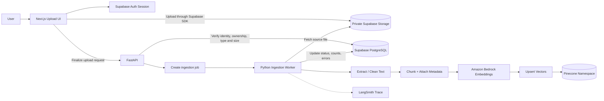
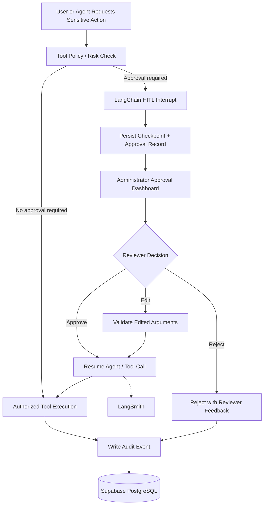
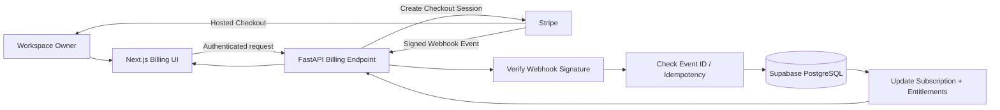

# Atlas Enterprise AI

> **TECHNOLOGY AMENDMENT (2026-11-07):** Former Appwrite Auth/Database/Storage/Functions requirements are **replaced by Supabase Auth + Supabase PostgreSQL + Supabase Storage**, plus a **Python ingestion worker**. See `docs/supabase-migration.md`. Prefer that document, `requirements.md`, `architecture.md`, and `environments.md` for current stack truth.

## Project Overview and System Architecture

**Document version:** 2.0  
**Updated:** November 7, 2026  
**Document status:** Updated technology and architecture specification

---

## 1. Project Goal

Build an enterprise-ready AI knowledge copilot that allows employees to ask natural-language questions about organizational documents and receive grounded, contextual answers. The platform combines secure document ingestion, retrieval-augmented generation (RAG), persistent conversation memory, context engineering, safety controls, human-in-the-loop (HITL) approval for sensitive actions, subscription/payment management, and end-to-end AI observability.

Atlas Enterprise AI will provide a single workspace where employees can upload approved organizational documents, search their contents through natural-language questions, ask follow-up questions, and receive answers with supporting source references. Administrators will manage documents, users, permissions, approvals, usage, and subscription-related settings through the application dashboard.

The system will use **FastAPI and Python** for backend APIs and AI services, **Supabase** for authentication and file storage, **Supabase PostgreSQL** for relational persistence, **Next.js** for the frontend, **LangChain** for agent and RAG orchestration, **Amazon Bedrock** for model inference and embeddings, **Pinecone** for vector retrieval, **LangSmith** for tracing and evaluation, and **Stripe** for payment processing.

## 2. Problem Statement

Organizational knowledge is scattered across policies, handbooks, procedures, and internal documents. Employees waste time searching for answers, responses can be inconsistent, and ordinary chatbots may hallucinate, lack access to current documents, or provide insufficient controls for sensitive operations.

Enterprise teams also need:

- Reliable answers grounded in the organization's approved source documents.
- Secure access boundaries between organizations, workspaces, and users.
- Conversation memory that supports follow-up questions without sending unlimited chat history to the model.
- Context selection that gives the model only the relevant, permitted information.
- Human review before sensitive tools or administrative actions execute.
- Guardrails for prompt injection, sensitive information, unsafe tool usage, and unsupported answers.
- Visibility into retrieval quality, model behavior, token usage, latency, failures, and cost.
- A consistent way to manage plans, subscriptions, and payments.

## 3. Proposed Solution

Atlas Enterprise AI provides a secure, multi-tenant chat interface over approved enterprise documents.

Users authenticate through **Supabase Auth**. The Next.js application uses the official **Supabase Auth helpers (@supabase/ssr / @supabase/supabase-js)** for authentication state, hooks, and SSR session handling, while **shadcn/ui** provides the actual application interface and auth forms. The browser communicates with **FastAPI** for backend operations. FastAPI verifies the user's Supabase identity and applies organization/workspace authorization before accessing protected data or invoking AI workflows.

Original documents are stored in private **Supabase Storage** buckets. A Python ingestion worker retrieves uploaded files, extracts and cleans text, splits content into searchable chunks, generates embeddings through **Amazon Bedrock**, and writes vectors to **Pinecone**. Pinecone namespaces isolate vector records by organization or workspace. Document metadata, chat records, approvals, audit events, memory records, and billing references are persisted in **Supabase PostgreSQL**, accessed directly through **SQLModel** and SQLAlchemy.

The RAG and agent workflow uses **LangChain's agent and retrieval APIs**. It loads the appropriate short-term conversation state and approved long-term memory, constructs a bounded context using context-engineering rules, retrieves relevant Pinecone chunks, calls an Amazon Bedrock chat model, and validates the result with application and LangChain guardrails. Responses include source references where supporting evidence is available.

Sensitive operations can be paused by **LangChain Human-in-the-Loop middleware** for human approval, editing, or rejection. Durable agent state/checkpoints allow the request to resume after a reviewer makes a decision. **LangSmith** traces instrumented model, retrieval, tool, and ingestion operations. **Stripe** handles checkout and subscription payments; verified Stripe webhook events update the application's billing records in Supabase PostgreSQL.

## 4. Real-World Use Cases

### HR and employee policies

Employees can ask about leave entitlement, working hours, remote work, benefits, onboarding rules, and other HR policies. Answers should cite the relevant policy and section whenever possible.

### IT and security knowledge

Employees can find approved guidance for password resets, MFA, device security, access requests, and incident reporting. The assistant must not disclose secrets or privileged information.

### Operations and travel policies

Employees can retrieve reimbursement rules, approval chains, procurement processes, travel policies, and internal operational guidance.

### Multi-turn knowledge assistance

Employees can ask follow-up questions without repeating the original context. Short-term memory preserves relevant conversation state, while context engineering determines which history and retrieved sources should be included in each model call.

### Controlled administrative requests

Requests such as document deletion, permission changes, policy modification, or other privileged operations can be routed to an administrator for approval before a separately authorized executor performs the action.

### Workspace and subscription management

Organization owners can manage workspace membership, plan information, subscription status, and billing workflows. Stripe processes payments; application access is determined by verified webhook-backed subscription state, not by a browser success redirect.

---

## 5. Technology Stack and Responsibilities

Each component has a defined role in the system.

| Layer | Technology | Responsibility |
|---|---|---|
| Backend language | Python | Backend services, document processing, RAG pipelines, agent tools, billing integration, and worker processes. |
| Backend API | FastAPI | REST APIs for chat, uploads, document management, ingestion, approvals, billing, feedback, and health/metrics endpoints. |
| Data modeling / ORM | SQLModel | Typed relational models and database access through SQLAlchemy against Supabase PostgreSQL. |
| Database migrations | Alembic (recommended) | Versioned, repeatable PostgreSQL schema migrations. |
| Relational database | Supabase PostgreSQL | Persists application records, conversations, messages, document metadata, memory, approvals, audit events, and billing state. |
| Authentication | Supabase Auth | User registration, sign-in, sessions, JWTs, MFA and identity management. |
| File storage | Supabase Storage | Stores original uploaded documents in private buckets with access permissions. |
| Frontend framework | Next.js App Router + TypeScript | Application dashboard, server/client rendering, chat experience, document management, approvals, and account pages. |
| Auth integration | Supabase Auth helpers (@supabase/ssr / @supabase/supabase-js) | Supabase client provider, auth hooks, user/session state, and Next.js SSR auth handlers. It is not a prebuilt visual auth component library. |
| UI components | shadcn/ui | Sign-in/sign-up forms, navigation, chat UI, document lists, dialogs, approval screens, settings, and billing components. |
| AI framework | LangChain | RAG components, model integration, agent creation, tools, middleware, prompts, and structured responses. |
| Conversation memory | LangChain agent state + checkpointer | Persists thread-scoped conversation state and supports resuming interrupted agent runs. |
| Long-term memory | LangChain Store interface + application persistence | Stores explicitly selected user/workspace memories, preferences, and summaries across conversations. |
| Human approval | LangChain HumanInTheLoopMiddleware | Pauses configured tool calls for approval, editing, or rejection before side effects occur. |
| Context engineering | LangChain runtime context, state, prompts, and middleware | Controls identity, permissions, memory, retrieved evidence, tool outputs, token budget, and model context. |
| LLM inference | Amazon Bedrock via `langchain-aws` | Runs the configured chat model for answer generation, reasoning, and supported agent tasks. |
| Embeddings | Amazon Bedrock Embeddings | Converts document chunks and user queries into vectors. Titan Text Embeddings V2 can remain the initial candidate from the original design. |
| Vector database | Pinecone | Stores document chunk embeddings and metadata; retrieves relevant chunks inside tenant/workspace namespaces. |
| Guardrails | LangChain middleware + deterministic Python validation | Validates inputs, retrieved content, tool requests, and outputs; enforces application policies and response requirements. |
| Observability | LangSmith | Traces agent steps, prompts, LLM calls, retrieval, tools, latency, token usage, errors, and evaluation results. |
| Payments | Stripe | Processes checkout, subscriptions, invoices, and payment events. |
| Billing integration | FastAPI + Stripe Python SDK | Creates checkout/portal sessions, verifies Stripe webhook signatures, and synchronizes billing state. the Python ingestion worker may be used for event-driven variants, but there should be one authoritative webhook processor. |
| Ingestion worker | Python worker process | Extracts text, chunks documents, generates embeddings, upserts Pinecone records, and updates document/job status. |

### Important technology decisions

1. **Use Supabase PostgreSQL, not TablesDB, as the SQLModel database.** SQLModel is built on SQLAlchemy and works with SQL databases. Supabase PostgreSQL exposes a standard PostgreSQL connection, and Supabase documents a FastAPI/SQLAlchemy integration. Native PostgreSQL is provisioned on dedicated infrastructure, so confirm that the selected Supabase plan supports it. TablesDB (rejected) is a separate API-based database product and is not a SQLModel backend. Do not attempt to point SQLModel at the TablesDB API.
2. **The Supabase Auth helpers (@supabase/ssr / @supabase/supabase-js) is not a complete visual auth UI kit.** It supplies authentication hooks, provider context, and Next.js SSR integration. Build the visual forms and screens with shadcn/ui, then connect them to Supabase auth helpers.
3. **Stripe is the payment processor.** Supabase provides the application platform and can host Functions for a Stripe integration, but Supabase itself does not replace Stripe's payment processing. This architecture places the checkout and webhook business logic in the Python/FastAPI backend.
4. **LangChain is the application-facing agent framework.** Use LangChain's `create_agent`, retrieval components, tools, and middleware rather than designing a custom LangGraph workflow. Current LangChain agents use the LangGraph runtime internally; checkpointing and interrupt/resume behavior therefore rely on that runtime even when the application is written against LangChain APIs.
5. **Embedding model selection is a separate decision from chat model selection.** The embedding model, vector dimension, normalization behavior, and Pinecone index configuration must remain compatible. The original document selected Amazon Bedrock Titan Text Embeddings V2 at 1,024 dimensions; retain that as the starting candidate only after confirming model access and the chosen configuration in the target AWS region.

---

## 6. System Architecture

The system has five connected paths:

1. Document upload and ingestion.
2. Authenticated conversational RAG and memory.
3. Human approval and controlled tool execution.
4. Billing and subscription synchronization.
5. Cross-cutting tracing, evaluation, and audit logging.

### 6.1 High-Level System Architecture

```mermaid
flowchart TB
    USER[Employee / Administrator]
    UI[Next.js App Router + TypeScript\nshadcn/ui]
    AUTH[Supabase Auth\nSupabase Auth helpers (@supabase/ssr / @supabase/supabase-js)]
    API[FastAPI Backend\nPython]
    DB[(Supabase PostgreSQL\nSQLModel / SQLAlchemy)]
    STORAGE[(Supabase Storage\nPrivate document buckets)]
    WORKER[Python Ingestion Worker]
    EMBED[Amazon Bedrock\nEmbedding Model]
    PINECONE[(Pinecone\nTenant/Workspace Namespaces)]
    AGENT[LangChain Agent + RAG]
    MEMORY[LangChain Memory\nCheckpointer + Long-term Store]
    LLM[Amazon Bedrock\nChat Model]
    GUARD[LangChain + Python Guardrails]
    HITL[Human-in-the-loop\nApproval Queue]
    STRIPE[Stripe\nCheckout / Subscriptions]
    LANGSMITH[LangSmith\nTracing / Evaluation]

    USER --> UI
    UI <--> AUTH
    UI -->|Supabase access token| API
    API <--> DB
    UI -->|Authenticated file upload| STORAGE
    API --> STORAGE
    API --> WORKER
    WORKER -->|Read original file| STORAGE
    WORKER --> EMBED
    EMBED --> WORKER
    WORKER -->|Upsert vectors| PINECONE
    WORKER -->|Document and job status| DB
    API --> AGENT
    AGENT <--> MEMORY
    AGENT -->|Retrieve by trusted namespace| PINECONE
    AGENT --> LLM
    LLM --> AGENT
    AGENT --> GUARD
    GUARD --> API
    AGENT --> HITL
    HITL --> DB
    HITL -->|Resume after decision| AGENT
    API <--> STRIPE
    STRIPE -->|Signed webhook| API
    API -->|Update verified billing state| DB
    API -.-> LANGSMITH
    WORKER -.-> LANGSMITH
    AGENT -.-> LANGSMITH
    LLM -.-> LANGSMITH
```

### 6.2 Document Upload and Ingestion Architecture



**Ingestion flow**

1. An authenticated user selects a supported document in the Next.js dashboard.
2. The browser uploads the original file through the Supabase Storage SDK. The target bucket is private; upload permissions and file-level access rules are enforced.
3. The frontend calls FastAPI to finalize the upload. FastAPI verifies the Supabase identity, checks workspace membership, validates the file metadata and limits, and creates the document record plus an ingestion job in PostgreSQL.
4. A Python worker claims the pending job using a lease/lock pattern, retrieves the file from Supabase Storage, extracts text, cleans it, and records extraction metadata.
5. The worker splits the extracted content into chunks. Each chunk receives metadata such as `tenant_id`, `workspace_id`, `document_id`, `chunk_id`, source title, page/section reference, and access scope.
6. The worker generates embeddings using the configured Amazon Bedrock embedding model.
7. The worker upserts vectors to the Pinecone namespace derived by the backend from the verified tenant/workspace identity. The namespace must never be accepted as an unrestricted browser-supplied value.
8. The worker records the vector/indexing results and changes the document status to `ready`. Failures are recorded with retryable/non-retryable status and safe error details.

**Suggested document status lifecycle**

`upload_pending -> uploaded -> queued -> processing -> ready`

Failure/deletion states: `failed`, `deleting`, and `deleted`.

The ingestion worker should be idempotent. Reprocessing the same document version should use deterministic vector IDs or a versioned ID strategy so retries do not create duplicate chunks. Document deletion must remove or deactivate its vectors as well as the original file and metadata according to the retention policy.

### 6.3 Conversational RAG, Memory, and Context Engineering

```mermaid
flowchart LR
    USER[User Question] --> UI[Next.js Chat UI]
    UI -->|Supabase access token| API[FastAPI Chat Endpoint]
    API --> AUTH[Verify Supabase Identity]
    AUTH --> ACCESS[Resolve Tenant, Workspace, Roles]
    ACCESS --> CONTEXT[Build Trusted Runtime Context]
    CONTEXT --> MEMORY[Load Thread Memory + Approved Long-term Memory]
    MEMORY --> LANGCHAIN[LangChain Agent / RAG Workflow]
    LANGCHAIN --> GUARDIN[Input Guardrails]
    GUARDIN --> RETRIEVE[Embed Query with Bedrock]
    RETRIEVE --> PINECONE[(Pinecone Tenant Namespace)]
    PINECONE --> RERANK[Filter / Rank / Select Evidence]
    RERANK --> BUILD[Context Budget + Prompt Assembly]
    BUILD --> MODEL[Amazon Bedrock Chat Model]
    MODEL --> GUARDOUT[Output / Citation Guardrails]
    GUARDOUT --> SAVE[Persist Message + Memory State]
    SAVE --> DB[(Supabase PostgreSQL)]
    GUARDOUT --> UI
    LANGCHAIN -.-> TRACE[LangSmith]
    RETRIEVE -.-> TRACE
    MODEL -.-> TRACE
```



**Chat flow**

1. A user submits a question from the chat interface.
2. FastAPI verifies the user's Supabase access token using a per-request Supabase SDK client and resolves the user's organization, workspace, role, and permissions. Client-supplied tenant or namespace identifiers are not trusted.
3. FastAPI loads the conversation and passes a stable conversation/thread identifier to the LangChain agent. The agent loads the corresponding short-term checkpoint and permitted long-term memory.
4. Context engineering prepares the model input. It selects relevant recent turns, a compact conversation summary when needed, approved memory, workspace policies, retrieved document evidence, and tool descriptions within a defined token budget.
5. The query is embedded using the same embedding model/configuration used for document indexing.
6. Pinecone is queried only inside the trusted tenant/workspace namespace. Metadata filters further constrain results to documents the current user is allowed to access.
7. Retrieved chunks are ranked/filtered and assembled with their source metadata. The system avoids presenting retrieved text as trusted instructions; document content is evidence, not policy.
8. LangChain calls the configured Amazon Bedrock chat model.
9. Output guardrails validate the response, check required citations/format, and prevent unsupported claims or prohibited disclosures.
10. FastAPI persists the user and assistant messages and memory/checkpoint changes. The response is returned to the UI with source references.

### 6.4 Human-in-the-Loop Approval Architecture



**HITL flow**

1. The agent proposes a tool call for a sensitive operation, such as document deletion, permission modification, or policy change.
2. LangChain HumanInTheLoopMiddleware checks the configured policy for that tool and its arguments.
3. If approval is required, execution pauses before the side effect. The agent checkpoint and a human approval record are persisted.
4. An authorized reviewer sees the requested action, requester, target resource, reason, and relevant context in the dashboard.
5. The reviewer approves, edits, or rejects the request, subject to the configured allowed decisions.
6. The agent resumes from its checkpoint. An approved or edited tool call is revalidated for authorization and executes through a narrowly scoped service function; a rejected call does not execute.
7. The system records the decision and execution result in the audit trail.

**Important:** An approval record alone does not delete a document or modify a policy. The corresponding executor must be implemented explicitly. Approval must not bypass normal authorization, tenant checks, or idempotency controls.

### 6.5 Payments and Subscription Architecture



**Payment flow**

1. An authenticated workspace owner selects a plan in the Next.js billing page.
2. FastAPI verifies the user's role and creates a Stripe Checkout Session using server-side Stripe credentials.
3. The user completes checkout on Stripe-hosted pages.
4. Stripe sends a signed webhook event to the FastAPI webhook endpoint.
5. FastAPI verifies the signature using the raw request body and webhook signing secret, checks event idempotency, and maps the Stripe customer/subscription to the correct application workspace.
6. FastAPI persists the verified billing event and updates subscription status, plan, renewal/cancellation timestamps, and entitlements in Supabase PostgreSQL.
7. Product access is based on the server-side subscription record. A browser redirect or client-provided payment status is never treated as proof of payment.

Supabase has an official Stripe subscription tutorial using the Python ingestion worker. This project can use that pattern if billing event handling is moved into a Function, but it must not process the same webhook independently in both FastAPI and a Python ingestion worker. Keep one authoritative webhook processor.

### 6.6 Observability and Audit Architecture

LangSmith is used for AI execution observability. Instrument the LangChain agent, retrieval calls, Amazon Bedrock model calls, tool invocations, and relevant ingestion operations. Capture trace IDs in application logs so a support or engineering user can connect an application request to its AI trace.

Track at least:

- End-to-end request latency and per-step latency.
- Bedrock model name, token usage, request failures, and retry counts.
- Retrieval namespace, top-k, filters, returned document IDs, and retrieval scores where available.
- Agent/tool call sequence, HITL interrupt events, and approval outcomes.
- Ingestion duration, extracted character/page counts, chunk counts, embedding failures, and indexing status.
- User feedback and evaluation results, including groundedness and citation coverage.

Do not export raw document contents, full prompts, secrets, access tokens, payment details, or personal information to LangSmith by default. Apply redaction and content-capture settings deliberately. Application audit records in PostgreSQL remain distinct from LangSmith traces: the audit log is the business/security record; LangSmith is the AI execution diagnostic record.

---

## 7. How the Architecture Works

### Authentication and authorization

Supabase Auth manages account identity and sessions. The Next.js application uses the Supabase Auth helpers (@supabase/ssr / @supabase/supabase-js) for provider state and auth operations. In SSR mode, the Supabase handler route manages the session cookie. For FastAPI requests, the frontend obtains a short-lived Supabase access token and sends it as a bearer token. FastAPI verifies it by creating a Supabase server SDK client for that request, setting the JWT, and retrieving the authenticated account. The verified Supabase user ID—not a user ID supplied in the body—is the identity used for authorization and data scoping.

### Relational persistence

Supabase PostgreSQL is the source of truth for application records. SQLModel/SQLAlchemy connects to its standard PostgreSQL endpoint using TLS and a connection pool. Alembic manages schema migrations. Supabase PostgreSQL connection is direct SQL access; TablesDB (rejected) permissions are not automatically applied to raw SQL connections. Enforce tenant authorization in FastAPI and use PostgreSQL roles and row-level security (RLS) as defense in depth.

For pooled connections, set the tenant context transaction-locally and run each protected query in the same transaction. Do not rely on a session-level setting that may leak or disappear across pooled connections.

### Document storage and indexing

Supabase Storage stores original files. PostgreSQL stores metadata and processing state; Pinecone stores chunk vectors and retrieval metadata. The application must keep these systems consistent through idempotent jobs and explicit deletion/re-indexing workflows. A database record should not be marked `ready` until the expected vector upserts have succeeded.

### RAG and model execution

LangChain handles prompt composition, retrieval integration, agent/tool execution, structured responses, and middleware. Amazon Bedrock provides the chat model and the embedding model. Pinecone provides semantic retrieval. The assistant should answer from authorized retrieved evidence, provide citations wherever source metadata permits, and clearly say when the available documents do not support an answer.

### Conversation memory

Short-term memory is thread-scoped and keyed by a stable conversation identifier. A production checkpointer persists agent state so conversations can continue and interrupted operations can resume after a restart. Long-term memory is separate: store only useful, explicitly permitted user- or workspace-scoped facts, preferences, or summaries. Do not blindly save every model inference as a memory. Memory reads and writes must follow tenant authorization, retention, and review rules.

### Context engineering

Context engineering controls what the model sees on each turn. It is more than adding chat history to a prompt. The workflow should:

- Pass verified runtime context such as user ID, tenant/workspace ID, role, permissions, and request ID through LangChain's runtime context.
- Retrieve only documents the user can access.
- Include the current request, relevant recent turns, and a concise summary when the conversation is long.
- Load only approved long-term memory relevant to the question.
- Separate trusted system/developer policy from untrusted document text and user content.
- Rank, deduplicate, and limit retrieved chunks by a configurable context/token budget.
- Preserve source IDs, page/section information, and citation mappings through generation.
- Avoid sending unnecessary personal data, entire documents, or unrelated conversation history to the model.

### Guardrails and safe execution

Use layered checks before retrieval, before tool execution, and after model generation. Deterministic checks are appropriate for explicit rules, formats, prohibited fields, and access policies. Model-based checks can support semantic classification but must not replace authorization. Tools must be allowlisted, narrowly scoped, schema-validated, and idempotent where possible. The model must never be the authority for deciding which tenant's data a user may access.

### HITL and controlled operations

Use LangChain's human-in-the-loop middleware for configured tool calls that require review. A checkpointer is required so the agent can pause and resume safely. Approval records should contain the requester, tenant/workspace, requested action, tool name, sanitized arguments, reviewer, decision, timestamps, and execution status. Revalidate permissions and resource state after resumption because access can change while a request is waiting for review.

### Payments

Stripe is authoritative for payment processing. PostgreSQL stores a local, webhook-synchronized representation of customers, subscriptions, plan IDs, billing status, and entitlements. Webhook events must be signature-verified, deduplicated, and processed idempotently. Never grant paid access solely because the browser reached a success URL.

---

## 8. Application Functionalities

| Functionality | Description |
|---|---|
| User authentication | Register, sign in, sign out, password recovery, session management, and supported MFA/social login through Supabase Auth. The frontend uses Supabase JS/SSR hooks and shadcn/ui screens. |
| Workspace and roles | Support organizations/workspaces, memberships, invitations, and roles such as owner, administrator, manager, and member. Every request and data query must be scoped to the verified workspace. |
| Document upload and ingestion | Upload supported documents to private Supabase Storage buckets. The Python worker extracts and chunks content, generates Bedrock embeddings, upserts Pinecone vectors, and tracks document/job status in PostgreSQL. |
| Enterprise RAG chat | Ask natural-language questions. LangChain retrieves relevant Pinecone context and uses Amazon Bedrock to generate document-grounded answers with source references where available. |
| Persistent conversation memory | Store messages and short-term agent state with a durable checkpointer; use recent turns and summaries for follow-up questions. |
| Long-term memory | Store permitted user/workspace preferences and summaries across conversations with explicit scope, retention, and write rules. |
| Context engineering | Construct a bounded, permission-aware model context from runtime identity, policies, conversation state, approved memory, retrieved sources, and tool definitions. |
| Input and output guardrails | Detect prompt-injection patterns, secret-exfiltration requests, sensitive content, unsafe responses, invalid structured output, and missing citations where required. |
| Tool safety | Validate tool schemas, authorization, tenant scope, resource ownership, idempotency, and side effects before execution. |
| Human-in-the-loop | Route sensitive tool calls to a pending approval queue. Administrators can approve, edit, or reject according to the configured policy. |
| Audit trail and feedback | Record important application events and approval decisions in PostgreSQL; capture user feedback and review outcomes for continuous improvement. |
| AI observability with LangSmith | Trace LangChain runs, model calls, retrieval, tool use, token usage, latency, and failures; configure privacy-aware capture and redaction. |
| Billing and subscriptions | Create Stripe Checkout sessions, handle signed webhooks, synchronize subscription records, and enforce plan entitlements on the backend. |
| Dashboard and usability | Provide chat, document library, upload progress, approvals, workspace settings, billing, and usage/metrics views. Keep chat at a fixed height with a scrollable message history and auto-scroll to new messages. |
| Tenant-aware data model | Associate organizations, workspaces, documents, conversations, vector namespaces, approvals, memory, and billing records with trusted tenant/workspace identifiers. Enforce isolation in FastAPI, PostgreSQL RLS, Supabase policies where applicable, and Pinecone namespace selection. |

---

## 9. Core Data and Isolation Model

The proposed relational model is stored in Supabase PostgreSQL and mapped with SQLModel. Supabase Auth remains the identity provider; do not duplicate passwords or authentication secrets in application tables.

Suggested relational entities:

| Entity | Purpose | Important scope / relationships |
|---|---|---|
| `organizations` | Customer organization/account | Organization ID and owner/member relationships. |
| `workspaces` | Logical knowledge workspace | Belongs to an organization; owns documents and conversations. |
| `memberships` | User-to-workspace membership and role | Supabase user ID, workspace ID, role, status. |
| `documents` | Original file metadata and processing status | Workspace ID, Supabase Storage file ID, owner, version, checksum, status. |
| `ingestion_jobs` | Durable processing job state | Document ID, attempts, lease, status, error code, timestamps. |
| `conversations` | Chat thread metadata | Workspace ID, owner/user ID, title, thread ID. |
| `messages` | User and assistant messages | Conversation ID, role, content reference, citations, timestamps. |
| `memory_records` | Approved long-term memory | User/workspace scope, memory type, content, source, consent/retention metadata. |
| `approvals` | Pending and completed HITL requests | Requester, reviewer, tool/action, sanitized arguments, decision, execution status. |
| `audit_events` | Security and business audit trail | Actor, tenant/workspace, action, target, timestamp, request/trace IDs. |
| `feedback` | User feedback and evaluation signals | Message/conversation ID, rating, comment, review status. |
| `billing_customers` | Stripe customer mapping | Organization/workspace ID and Stripe customer ID. |
| `subscriptions` | Local subscription and entitlement state | Stripe subscription ID, price/plan ID, status, period dates, cancellation state. |
| `stripe_webhook_events` | Processed webhook event ledger | Unique Stripe event ID, event type, processing status, timestamps. |

### Tenant and vector isolation rules

- Derive the current user ID from a verified Supabase access token.
- Resolve the user's allowed organization/workspace from trusted membership records.
- Derive Pinecone namespace names on the backend from internal tenant/workspace IDs; never trust a client-supplied namespace.
- Use a workspace namespace for vector isolation and metadata filters for document-level access where multiple roles or visibility scopes exist inside a workspace.
- Include tenant/workspace/document identifiers in vector metadata, but do not store secrets or unnecessary PII in vector metadata.
- Enforce PostgreSQL RLS and transaction-scoped tenant context for relational records. Supabase PostgreSQL connection does not automatically apply TablesDB (rejected) row permissions.
- Treat administrator access as an explicit, audited capability rather than a bypass hidden in ordinary query code.

---

## 10. Security, Reliability, and Operational Requirements

### Authentication and secrets

- Keep Supabase API keys, PostgreSQL credentials, AWS credentials, Pinecone API keys, LangSmith API keys, and Stripe secrets in server-side environment variables or a secrets manager.
- Never expose server API keys or secret credentials through `NEXT_PUBLIC_*` variables or browser bundles.
- Use least-privilege Supabase API key scopes and rotate credentials when required.
- Use short-lived Supabase access tokens for FastAPI requests and verify identity on every protected request.
- Use TLS for PostgreSQL and external service connections.

### Authorization and tenant security

- Apply authorization in FastAPI service functions, not only in frontend components.
- Check organization/workspace membership and role on every document, conversation, memory, approval, and billing operation.
- Apply PostgreSQL roles/GRANTs and row-level security policies as defense in depth.
- Set tenant context inside the transaction that performs protected SQL queries; pooled connections require transaction-local settings.
- Use Pinecone namespaces and metadata filters to prevent cross-tenant retrieval.
- Use private Supabase Storage buckets and explicit file permissions. Avoid public file URLs for confidential enterprise documents.

### Document and prompt security

- Validate file extension, detected MIME type, size, ownership, and supported parser before ingestion.
- Treat extracted document text as untrusted data. Prompt-injection-like instructions inside documents must not override system policies or tool permissions.
- Scan uploads where appropriate and isolate parser execution from the API process.
- Avoid returning raw storage credentials, internal prompts, or other tenant's content in errors or citations.

### Model and tool safety

- Use explicit tool allowlists and typed input schemas.
- Require HITL for destructive or high-impact operations.
- Recheck permissions at execution time, including after an approval wait.
- Use idempotency keys for operations that may be retried.
- Apply output validation and safe fallbacks when the model response is incomplete, unsupported, or violates policy.
- Never treat a guardrail as a replacement for authentication, authorization, database constraints, or human review.

### Reliability and lifecycle management

- Make ingestion jobs retryable and idempotent; store attempt counts and failure reasons.
- Use file checksums/version numbers to identify changed documents and prevent duplicate indexing.
- Keep source file, relational metadata, and Pinecone vector state synchronized during re-indexing and deletion.
- Use webhook event IDs to deduplicate Stripe events and safely retry failed processing.
- Persist agent checkpoints for HITL and long-running conversations. Define retention and cleanup rules for old checkpoints and memories.
- Apply request timeouts, bounded retries, rate limits, and concurrency limits to external model and vector services.

### Observability and privacy

- Use LangSmith projects/environments to separate development, staging, and production traces.
- Redact sensitive prompts, document text, user identifiers, and credentials before exporting traces.
- Record trace IDs and request IDs in application logs and audit records.
- Monitor model latency, retrieval latency, ingestion failures, webhook failures, token consumption, and per-workspace usage.
- Keep the security audit log in the application database; do not rely on observability traces as the only audit record.

---

## 11. Implementation Scope and Boundaries

The project overview defines the target architecture and observable application capabilities. It does not imply that every external integration or executor is already implemented.

- **HITL:** The approval workflow can persist decisions and resume a checkpointed agent. Approved deletion or policy modification only occurs when a corresponding safe executor has been implemented and tested.
- **Payments:** Stripe checkout, subscriptions, and webhook synchronization are included in the target architecture. Payment state must be confirmed through verified webhook events.
- **Memory:** Short-term conversation memory and long-term user/workspace memory are separate capabilities with separate retention and access policies.
- **Embeddings:** Amazon Titan Text Embeddings V2 is carried forward from the original document as the initial candidate. Confirm the AWS region, model access, vector dimension, and Pinecone index configuration before indexing production data.
- **Worker execution:** A Python worker and durable ingestion-job table are part of the target architecture. The exact process supervisor/deployment topology is an implementation decision; no external queue product is assumed in this overview.
- **Tenancy:** Tenant-aware IDs alone do not provide isolation. Authentication, authorization, RLS, private file permissions, namespace derivation, and retrieval filters must all be implemented and tested.
- **Observability:** LangSmith visibility depends on configured instrumentation, project settings, credentials, and privacy controls.

---

## 12. Official Documentation and Technical References

The following official references should be used during implementation. API names and SDK behavior should be checked against the versions selected for the project.

### Supabase

- [Supabase documentation](https://supabase.com/docs)
- [Supabase Auth](https://supabase.com/docs/guides/auth)
- [Supabase Auth with Next.js](https://supabase.com/docs/guides/auth/server-side/nextjs)
- [Supabase SSR (`@supabase/ssr`)](https://supabase.com/docs/guides/auth/server-side/creating-a-client)
- [Supabase Database (Postgres)](https://supabase.com/docs/guides/database/overview)
- [Supabase connection pooling](https://supabase.com/docs/guides/database/connecting-to-postgres#connection-pooler)
- [Supabase Storage](https://supabase.com/docs/guides/storage)
- [Supabase Storage Access Control](https://supabase.com/docs/guides/storage/security/access-control)
- [Supabase Python client](https://supabase.com/docs/reference/python/introduction)


### Python, FastAPI, and SQLModel

- [FastAPI documentation](https://fastapi.tiangolo.com/)
- [SQLModel documentation](https://sqlmodel.tiangolo.com/)
- [SQLModel and SQL databases](https://sqlmodel.tiangolo.com/databases/)

### LangChain and LangSmith

- [LangChain Python documentation](https://docs.langchain.com/oss/python/langchain/overview)
- [LangChain agents](https://docs.langchain.com/oss/python/langchain/agents)
- [LangChain memory concepts](https://docs.langchain.com/oss/python/concepts/memory)
- [LangChain human-in-the-loop](https://docs.langchain.com/oss/python/langchain/human-in-the-loop)
- [LangChain guardrails](https://docs.langchain.com/oss/python/langchain/guardrails)
- [LangChain runtime context](https://docs.langchain.com/oss/python/langchain/runtime)
- [LangChain agent API reference](https://reference.langchain.com/python/langchain/agents/factory/create_agent)
- [LangChain Amazon Bedrock integration (`langchain-aws`)](https://github.com/langchain-ai/langchain-aws)
- [LangSmith tracing](https://docs.smith.langchain.com/)

### Amazon Bedrock and Pinecone

- [Amazon Bedrock documentation](https://docs.aws.amazon.com/bedrock/)
- [Pinecone documentation](https://docs.pinecone.io/)
- [Pinecone Python SDK namespace guide](https://sdk.pinecone.io/python/how-to/vectors/namespaces.html)

### Stripe and frontend

- [Stripe documentation](https://docs.stripe.com/)
- [Next.js App Router documentation](https://nextjs.org/docs/app)
- [shadcn/ui documentation](https://ui.shadcn.com/docs)

---

**Atlas Enterprise AI — Updated Project Overview and System Architecture**
